# Preflight: Subscription Document QA

**Anduin Transactions challenge: the Legal Reviewer.** Review a fund's subscription document **before** it is digitized, so a broken clause never becomes a broken form.

Built by Thao Dao in four days for the Anduin Transactions job-application challenge. [LinkedIn](https://www.linkedin.com/in/thaodao0912/) · [Website](https://itsjiathao.com/)

**[Open the live demo](https://preflight-legal-reviewer.giathaowork.workers.dev)** · [Docs](docs/README.md) · [Architecture](docs/architecture/README.md)

## In one minute

| | |
|---|---|
| **The problem** | Anduin's Digitization Service Analyst turns each fund's subscription document (15 to 40 pages) into an online form by hand. A broken reference, a "skip to" that jumps the wrong way, or an annex that does not exist is easy to miss. When it is missed, the form is built wrong and **every investor who fills it** hits the same dead end. Even when the analyst spots something odd, they cannot settle it alone: only counsel, the GP or the fund admin can. |
| **The solution** | **Preflight** is one review step before the form build. Upload the whole fund package; get every finding with its **quote**, its **source file** and its **owner**; settle it with counsel on **one shared page**; the form build starts only when the gate says **Ready**; every answer is **remembered** for that law firm's next fund. |
| **Measured on the demo fund** | 7 of 10 seeded defects caught by deterministic rules alone, each with a quote. 9 changes against last year's fund shown, out of 214 raw text edits. A second fund from the same firm: 62.5% fewer findings to review. |


---

## 1. Who this is for: the Digitization Service Analyst

| | |
|---|---|
| **Who** | The Anduin analyst who reads a fund's subscription document and builds the online form: every question, every investor type, every "skip to" instruction. |
| **When** | A law firm sends a new fund's documents, or a new version of them. |
| **Inputs** | The subscription agreement plus the documents it cites: LPA, PPM, side letters, last year's fund, tax forms. |
| **What they need** | See what will break the form; see what changed since this firm's last fund; know who must confirm each point; build the form right the first time. |
| **What they fear** | Building on a guess, the GP rejecting the form, investors stuck halfway, and asking counsel the same question again next fund. |

### The insight

> **The bottleneck is not finding the issue. It is settling it.**

A sub doc changes for six reasons, each decided by someone else. The analyst only sees the final text.

| Source of a change | Example | Who decides |
|---|---|---|
| Law and regulation | Investor definitions, AML/KYC, FATCA/CRS | Regulators |
| Fund structure | Domicile, feeder and parallel funds | GP and counsel |
| Internal policy | Source-of-funds thresholds, minimum commitment | GP, fund admin |
| Side agreements | Side letters, special terms | GP and the investor |
| Drafting habits | Wording, template drift, plain mistakes | The law firm |
| Versions and timing | Drafts v1 to v4, changes mid-raise | Every party |

So the analyst **lacks intent** (deliberate, or a mistake?), **lacks authority** (they can guess a meaning; only counsel can say it) and **lacks visibility** (side letters and GP emails never reach them).

### Problem statement

> The analyst receives documents where every difference may come from law, fund structure, policy, side deals or drafting habits, but sees only the final text. They know enough to spot what is odd, not enough to decide it. Finding a deviation, judging its effect on the form and asking the right person is manual, scattered across email and never remembered, so forms are built on unclear input and rebuilt later.

### What review must do

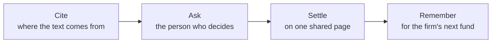

---

## 2. Today's flow, and where Preflight fits

**Today** (as I understand it from public material): step 2 is a manual read, so a defect written in at step 1 surfaces at steps 3 to 7.

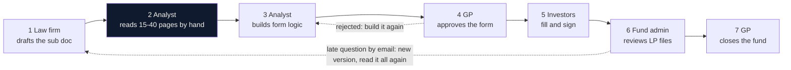

**With Preflight**: step 2 becomes a check with a gate. Questions go to the right owner once, with a quote, and the answers are kept.

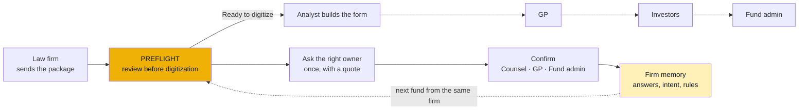

The defects that slip through a manual read, and how Preflight catches each one:

| Defect | Example | What it does to the form | Caught by |
|---|---|---|---|
| Missing reference | "See Section 11" but the content is Section 12 (real SEC filing) | Routes the investor to a dead end | Rule |
| Broken conditional skip | "If a Benefit Plan Investor, please complete Annex F", and no Annex F exists | Every investor of that type gets stuck | Rule |
| Investor-type gap | One investor type's path never reaches the signature page | That investor cannot finish | Rule |
| Typo that changes meaning | "shall" becomes "shall not" | Asks the wrong question | AI |
| Contradiction | Section 3 requires Annex B; Section 8 exempts the same investor | No single rule to build | AI |
| Term ambiguity | "pension plan or charity exempt from tax": does "exempt" cover both? | Two readings, two branch logics | AI |

---

## 3. The platform: one loop, from package to Ready

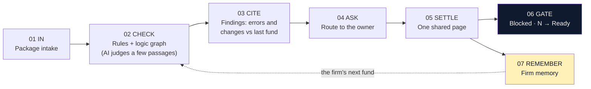

| Step | Feature | What the analyst gets | Screen |
|---|---|---|---|
| 01 In | **Fund Package Intake** | Up to 12 files. Each file's type and role is proposed with a reason; unsure ones are asked, never guessed. Outside references ("the LPA", "Annex F", W-8BEN-E) are resolved against the package. | Open a document |
| 02 Check | **Rules engine + logic graph** | 13 deterministic detectors. Every investor type's path through the document, section by section. | Structure |
| 02 Check | **AI judgment** (optional) | Ambiguity, contradictions and meaning-changing typos on a few graph-selected passages. Labelled AI, quote-checked, never gates. | Findings |
| 03 Cite | **Findings** | Each finding quotes the text, shows its location, and scrolls the document to it. | Findings |
| 03 Cite | **Source File** | When a check used another file (e.g. a term defined in the LPA), the finding names it and opens it in one click. | Findings → Details |
| 03 Cite | **Variance (Changes)** | Only the changes that matter against the firm's last fund, each with its impact on the form and a suggested owner. Cosmetic edits are hidden. | Findings → Changes |
| 04 Ask | **Triage** | Two buttons: **Ask counsel**, or **Close issue** with a required reason. | Findings |
| 05 Settle | **Share with counsel** | One signed link. Counsel types a name (no account), picks a reading, saves. The analyst sees the answer on the finding. | Findings |
| 05 Settle | **Questions per owner** | Counsel, GP and Fund admin tabs. One **For the GP** request lists every missing document with the sentence that cites it. DOCX export. | Questions |
| 06 Gate | **Digitization gate** | Blocked · N until every blocking item is answered, then Ready to digitize. | Sidebar |
| 07 Remember | **Firm memory** | Answers and dismissals with reasons, per law firm; suggested rules after 3 matching dismissals; append-only audit trail. | Firm memory |

No new screens were added for any of this: everything lives inside Findings, Questions, Structure, Compare and Firm memory.

---

## 4. End to end on demo package 01

Demo package 01 is a fictional fund, **Northgate Infrastructure Fund III** (law firm Hartwell & Crane LLP), with 10 seeded defects and an [answer key](samples/packages/01-northgate-infrastructure-iii/answer-key.md).

**01 · Open the package.** Six files. Preflight proposes each file's type and role with a reason. Two files are both subscription agreements, so it asks which one to digitize instead of guessing.

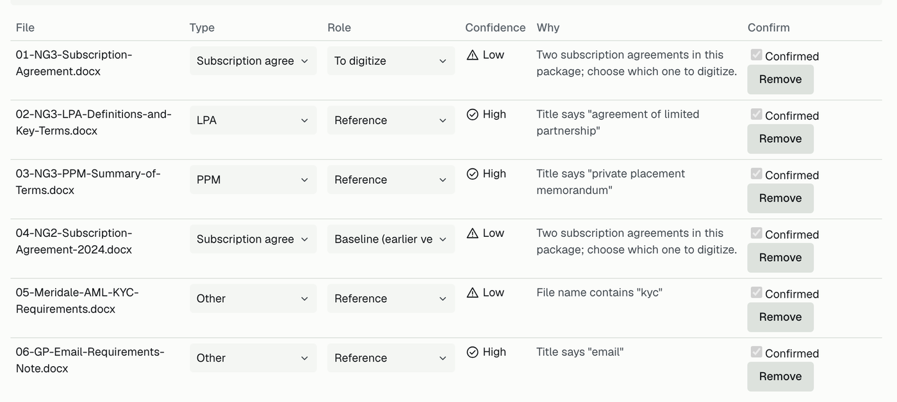

**02-03 · Find what breaks the form.** The first finding is the broken path: Section 9 tells a Benefit Plan Investor to "please complete Annex F", and there is no Annex F. The finding quotes the sentence and blocks digitization.

<p>
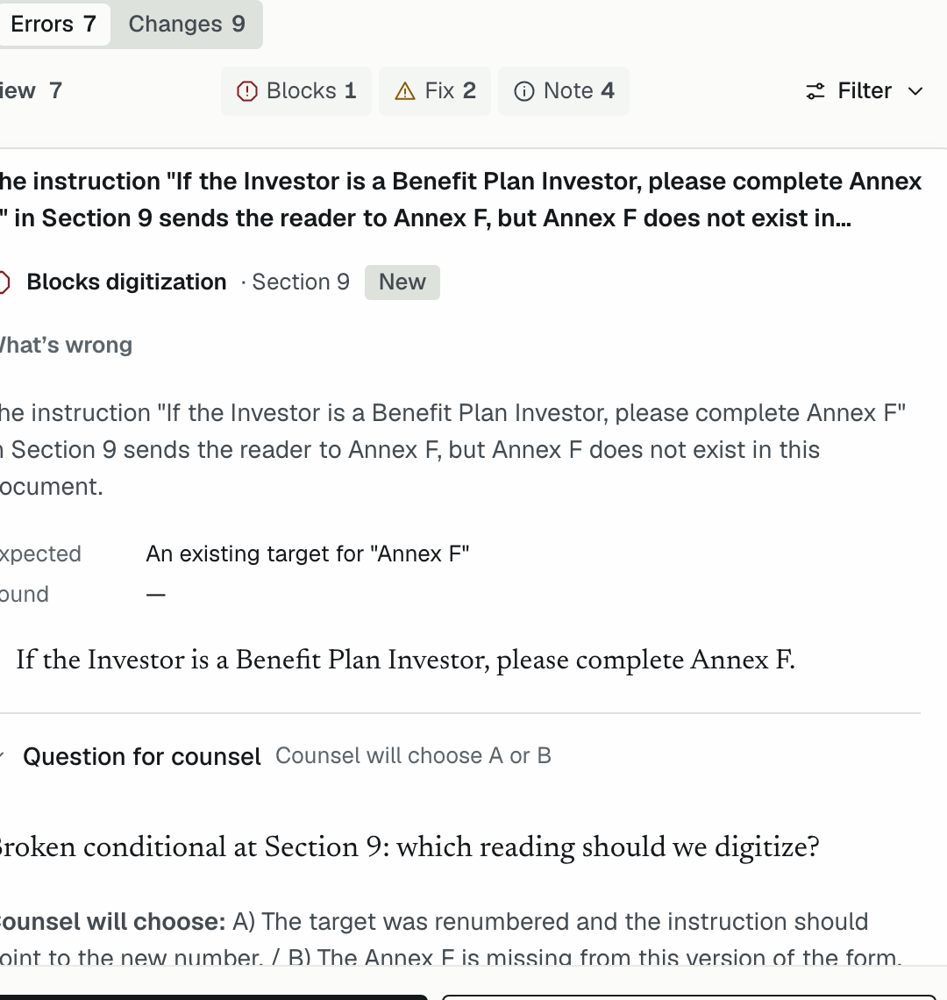
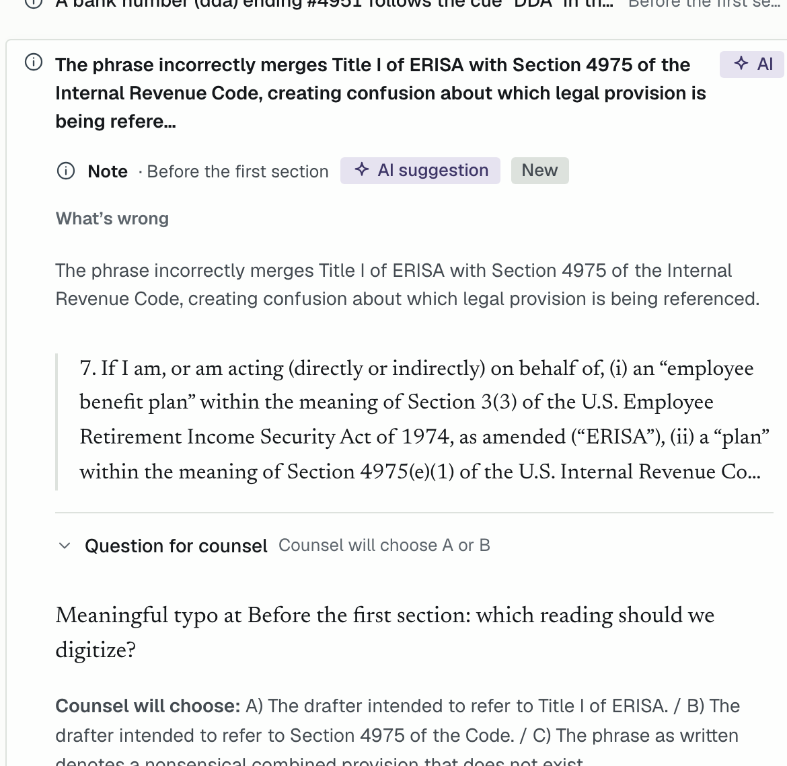
</p>

Left: a rule finding. Right: an AI row on a public SEC filing, labelled AI, with readings for counsel; it never counts toward the gate.

**03 · See the source.** The word "Units" is used but not defined in the sub doc. Source File shows the check used the LPA and the PPM, and one click opens the LPA.

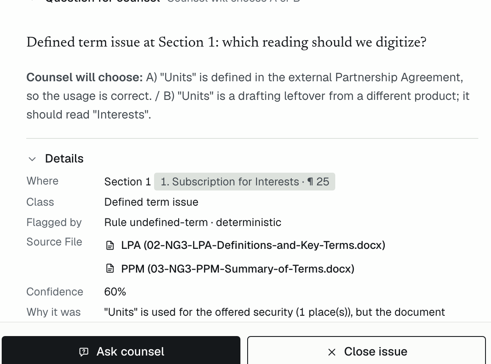

**03 · Only what changed.** Against Fund II, Section 4 gains seven words, "formed or organized outside the United States". A new law, a GP decision or a slip? The analyst cannot tell, and it is not their call. Preflight shows the impact (US entities lose a question; last year's form rule cannot be reused) and routes it to **GP + Counsel**.

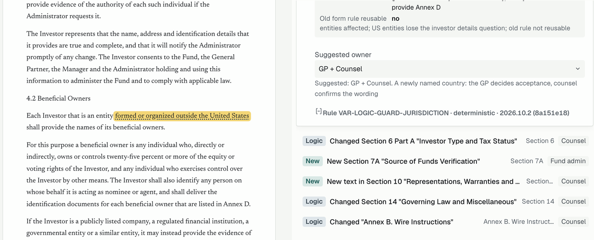

**04-05 · Ask, and settle on one page.** The analyst clicks **Ask counsel**, then **Share with counsel**. Counsel opens the link, picks a reading and saves. The analyst sees who answered, and the gate count drops.

<p>
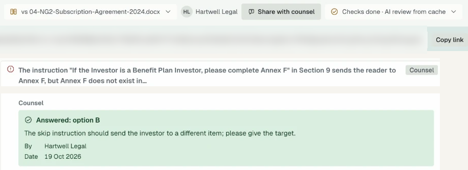
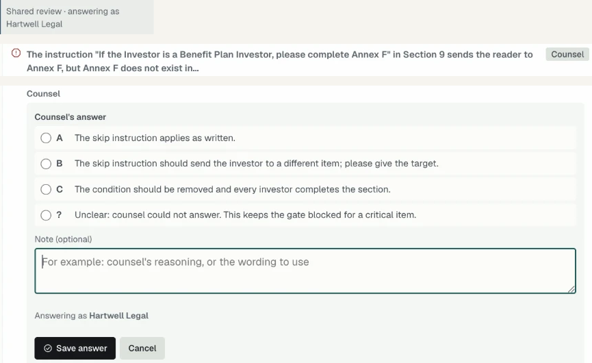
</p>

**05 · One request to the GP.** Every document the package cites but does not include (7 here), each with the sentence that mentions it.

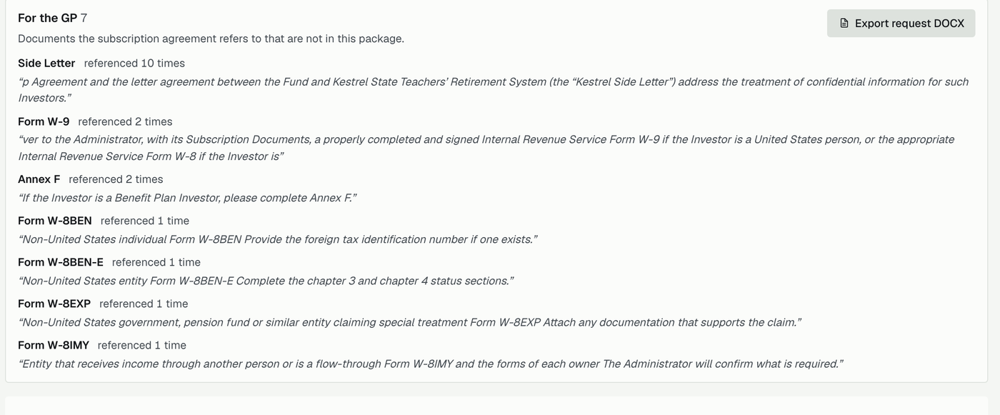

**07 · Remember.** Every answer and every closing reason is kept for that law firm. On the firm's next fund the same finding comes back labelled. When the same pattern is dismissed three times, Preflight suggests a firm rule for the analyst to review; an active rule is context for the AI only, never a filter. (Screenshots: the seeded demo workspace, Partners Group, with a simulated analyst.)

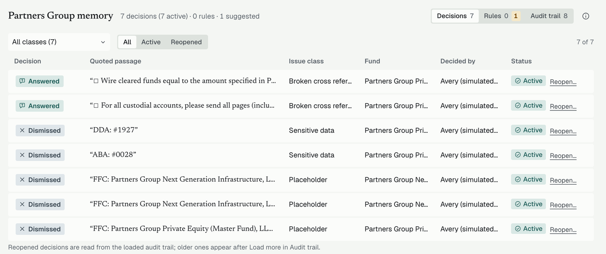

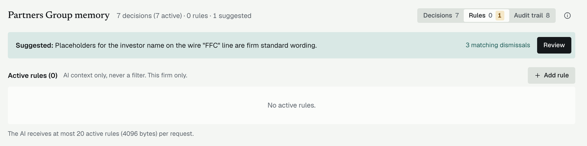

---

## 5. The value

Counts are measured on the bundled samples and demo packages. Nothing was timed with real analysts, so time savings are not claimed.

| Measure | Result | Source |
|---|---|---|
| Seeded defects caught on demo package 01 | **7 of 10** by deterministic rules alone, each with a quote | [answer key](samples/packages/01-northgate-infrastructure-iii/answer-key.md) |
| Fund II reviewed after Fund I with firm memory | 8 findings, 5 already handled by memory: **62.5% fewer to review** | Phase 10 report (AC59), `process/general-plans/` |
| Variance demo (Fund III against Fund II) | 214 raw text changes, **7 shown**; 207 cosmetic hidden | Variance report (V4), `process/features/variance-management/` |
| Speed of the checks (in the browser) | 379 KB sample in 169 ms; six-file package to findings in about 229 ms | [docs/architecture/status.md](docs/architecture/status.md) |

What this replaces, by design:

- **Manual cross-reference tracing** across a 40-page document, repeated for every version.
- **Hand-written query emails**: counsel answers on a shared link, and the question sheet is generated.
- **Re-reviewing the same template points** on a firm's next fund: memory and variance carry them over.
- **Digitizing with an unresolved critical issue**: the gate blocks it.

**Why it is different.** Legal proofreaders (Litera Check, Definely Proof) serve the drafting lawyer and stop at the text. Investor platforms (Passthrough, Juniper Square) check what investors submit, after the fact. No tool I found checks a sub doc's conditional logic before digitization, routes each point to the person who can decide, and remembers the answer per law firm.

| Capability | Legal proofreaders | Platform review | Analyst by hand | **Preflight** |
|---|---|---|---|---|
| When it runs | While drafting | After submission | Before the build | **Before the build** |
| Cross-refs and terms | Yes | No | Slow, uneven | **Yes, with evidence** |
| Form logic and investor paths | No | No | Slow, uneven | **Yes, from the graph** |
| Counsel workflow and gate | No | No | Ad hoc email | **Yes, one shared link** |
| Memory across funds | No | No | In people's heads | **Yes, per law firm** |
| What changed vs last fund | Redline only | No | By hand | **Ranked, with owners** |

---

## 6. Technical implementation

### Design principles

- **Deterministic first, LLM second.** Rules decide; the model only judges clause neighborhoods picked from the graph, cannot override a rule finding, and never gates. The app works with AI off.
- **Every finding is checkable.** A quote, a location and the rule or model that flagged it. An AI finding whose quote cannot be found in the document is dropped.
- **Browser-first.** Parsing and checks run in the user's browser in a Web Worker. Full documents are never stored on the server.
- **Thin backend.** A Cloudflare Worker proxies AI and OCR (Turnstile, quotas, spend cap, content-hash cache) and serves the firm memory API on D1.
- **Integrate, do not add screens.** Each feature folds into an existing screen.

### Architecture


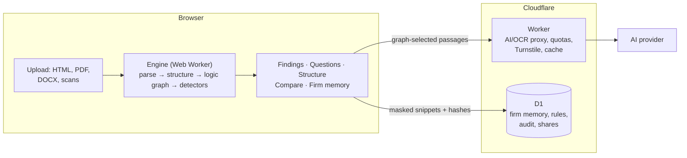

### How the technical flow works

1. **Upload and parse** in the browser: HTML, text PDF (unpdf), DOCX (mammoth) or scanned pages (OCR through the Worker).
2. **Line stream** of the document text with locations.
3. **Structurer** finds sections, cross-references, conditionals and defined terms.
4. **Logic graph** of sections, references and investor-type paths.
5. **Detectors** run on the graph and emit **findings with evidence** (quote plus location).
6. **Findings render first.** Memory and AI load after, so the analyst never waits on them.
7. **Optional AI pass** on graph-selected candidates: Turnstile-gated, cached by content hash, output schema-checked, quotes must be locatable or the finding is dropped.
8. **Memory lookup** by fingerprint. The server receives only masked snippets and hashes.
9. **Triage, gate and question sheet** in the browser. Documents and packages stay in the browser for 24 h.

<details>
<summary><b>The 13 deterministic detectors</b> (no AI; source: <code>packages/core/src/detectors/</code>)</summary>

| #   | Detector                     | What it catches                                                                                                              | Default severity                              |
| --- | ---------------------------- | ---------------------------------------------------------------------------------------------------------------------------- | --------------------------------------------- |
| 1   | `ref-this-section`           | "this Section N" where N is not the section it sits in                                                                       | Critical in a routing context, otherwise high |
| 2   | `ref-label-coherence`        | A reference whose label does not fit the cited target but fits another (e.g. swapped "Part B of Section 6")                  | Critical in a routing context, otherwise high |
| 3   | `broken-conditional`         | "If ..., complete / skip / proceed to Section N" where the target section, part, annex or question does not exist            | Critical                                      |
| 4   | `unreachable-flow`           | Jump instructions that form a cycle or leave a section unreachable                                                           | Critical                                      |
| 5   | `investor-path-dead-end`     | An investor type whose path never reaches the signature page                                                                 | Critical                                      |
| 6   | `investor-path-missing-item` | A required item missing from an investor type's path (e.g. told to "also complete Part C", but Part C is missing or skipped) | High                                          |
| 7   | `option-gap-overlap`         | Option groups with numeric gaps or overlaps, or "check one" groups that offer "All of the above"                             | High                                          |
| 8   | `footnote-requirement`       | Options in one group that carry footnote requirements inconsistently                                                         | High                                          |
| 9   | `defined-term-issues`        | The same term defined twice, or used before its definition                                                                   | High / medium                                 |
| 10  | `undefined-term`             | An offering-security noun (e.g. "Units" where the document defines "Shares") that is never defined                           | Medium                                        |
| 11  | `flag-drafting-note`         | Internal drafting notes left in ("NTD:", "Note to draft")                                                                    | Medium                                        |
| 12  | `flag-placeholder`           | Unfilled placeholders such as `[xx]`, `[insert ...]`, `[●]`                                                                  | Medium                                        |
| 13  | `flag-sensitive`             | Bank account and routing numbers after a cue word (ABA, DDA, account), masked to the last 4 digits                           | Medium                                        |

"Routing context" means the reference sits in instructions, an answer option or a conditional, where a wrong target would send the investor to the wrong place. These 13 detectors cover 11 issue classes. The other 4 classes are AI-only judgment (logic contradiction, ambiguity, meaningful typo) and version drift from the diff.

</details>

### Tech stack

| Layer   | What                                                                                                                                   |
| ------- | -------------------------------------------------------------------------------------------------------------------------------------- |
| Engine  | TypeScript 6 (ESM), htmlparser2 12, unpdf 1.9, mammoth 1.13, diff 9, zod 4.6, @noble/hashes 2.4 (`packages/core`)                      |
| Web     | React 19.3, Vite 8, Tailwind 4, Zustand 5, Dexie 4 (IndexedDB), Comlink 4 (Web Worker), Radix dialog and popover, pdfjs-dist 6, docx 9 |
| Backend | Cloudflare Workers (wrangler 4), D1, Turnstile; one AI provider chosen by `AI_PROVIDER` (see Known limits)                             |
| Testing | Vitest 4 (with the Cloudflare vitest plugin for the Worker), Playwright 1.64, fast-check 4, axe-core                                   |
| Tooling | pnpm 11 monorepo (`packages/core`, `apps/web`, `apps/worker`, `scripts`), eslint 10, prettier 3.9                                      |

### Try it

1. Open the [live demo](https://preflight-legal-reviewer.giathaowork.workers.dev), choose **Open a document** → **Or try a demo package** → **Northgate Capital III** (6 files). Set file 01 to **To digitize** and file 04 to **Baseline (earlier version)**, tick **Confirmed**, then **Run checks**. Measured live (No AI): 16 findings (7 errors, 9 changes vs Fund II) and the gate pill reads **Blocked · 10**.
2. Open a finding to see the quoted evidence (and its **Source File** when the check used another file in the package), then use **Ask counsel** or **Close issue**. **Share with counsel** creates a link counsel can answer on.
3. **Questions** shows the questions per owner (Counsel, GP, Fund admin), the **For the GP** request (7 missing documents) and the DOCX export. The pill stays Blocked until blocking items are answered.
4. **Real SEC filings**: the demo package **PG NGI 2024 + 2026** (Partners Group) shows the swapped "Part B" references and the drift between the two years in **Compare versions**.
5. **Firm memory** is in the sidebar, named after the open document's law firm.

AI review needs a quick human verification (Turnstile). Bundled samples have precomputed AI results and make no upstream calls. Walkthrough: [docs/walkthrough/demo-walkthrough.vi.md](docs/walkthrough/demo-walkthrough.vi.md) (Vietnamese).

### Run locally

Node 24+ and pnpm 11.

```bash
pnpm install
pnpm --filter @aduin/web dev    # SPA only, no AI
pnpm dev:stack                  # SPA plus the Worker locally (wrangler dev)
pnpm dev:stack:seeded           # SPA plus the Worker with a seeded firm memory on :8788
```

For local AI, put the provider key in the gitignored `apps/worker/.dev.vars`. Deploy and rollback: [docs/DEPLOY.md](docs/DEPLOY.md).

### Tests

There is no CI pipeline; every gate runs locally. Counts as of 18-10-26: core 3,190, worker 608, web unit 544, scripts 183, browser e2e 253 (plus 1 opt-in skip), stack-memory e2e 12.

| Gate                          | Command                                                             |
| ----------------------------- | ------------------------------------------------------------------- |
| Core (unit, golden, property) | `pnpm --filter @aduin/core test`                                    |
| Worker (local D1)             | `pnpm --filter @aduin/worker test`                                  |
| Web unit                      | `pnpm --filter @aduin/web test`                                     |
| Browser e2e                   | `pnpm --filter @aduin/web test:e2e`                                 |
| Accessibility (axe)           | `pnpm --filter @aduin/web test:a11y`                                |
| Stack with memory             | `pnpm --filter @aduin/web test:e2e:stack-memory`                    |
| Types, lint, safety guards    | `pnpm typecheck`, `pnpm lint`, `pnpm guard:cf`, `pnpm secrets:scan` |

Pass test file names as separate commands, not after a `--`.

### Known limits

- **Turnstile and AI:** live AI and OCR need a Turnstile token. Automated browsers get one only sometimes, so scripted live AI runs are not reliable.
- **Still missed on package 01:** 3 of 10 seeded defects (for example the "Eligible Transferee Certificate" and a $2.5M vs $5M minimum).
- **Structurer misses:** some heading styles are not recognized (for example sample 02 has no accepted sections; sample 12 sections 4 and 6). Some statutory citations and sub-letter references ("Section 4B") are misclassified.
- **Package intake:** some references and cross-document terms are missed (on the Lotus Bay demo package 2 of 3 GP requests are produced). Two sub agreements in one package need the analyst to pick roles. Type detection is rule-based only.
- **Compare** cannot diff scanned (OCR) documents. Editing a finding's text or severity is not built.
- **Variance:** digit changes in operative text count as logic, so demo package 01 shows 9 change rows rather than the answer key's 7.
- **Demo data:** public SEC documents and synthetic fund packages only. Do not upload real investor data.
- **AI provider and privacy:** the Worker calls one provider chosen by `AI_PROVIDER` (`openai` with `gpt-4.1-mini` live, `openrouter` as fallback). When AI review or OCR is used, sub-document text and scanned pages are sent to that provider. OpenAI spend has a $10 lifetime cap enforced in D1 (fails closed).
- **Not built for production:** accounts or SSO, tenant isolation beyond the sandbox workspace, a zero-retention LLM provider, CI.

Full lists with backlog pointers: [docs/architecture/status.md](docs/architecture/status.md).

## Documentation

- [docs/README.md](docs/README.md): reading paths by time budget
- [docs/architecture/README.md](docs/architecture/README.md), with [workflows](docs/architecture/workflows.md), [components](docs/architecture/components.md), [data model](docs/architecture/data-model.md), [decisions](docs/architecture/decisions.md) and [status](docs/architecture/status.md)
- [docs/DEPLOY.md](docs/DEPLOY.md): deploy, rollback, live checks
- [docs/demo/](docs/demo/): [script](docs/demo/script.md), [storyboard](docs/demo/storyboard.md), [slides](docs/demo/slides.html)
- <!-- DRIVE_LINK --> Demo video and slides: (link coming)
- [samples/sub-docs/README.md](samples/sub-docs/README.md) and [samples/packages/README.md](samples/packages/README.md): test inputs with known defects
- [design/mockups/](design/mockups/): approved mockups
- [THIRD_PARTY_NOTICES.md](THIRD_PARTY_NOTICES.md): dependency licenses

## Author

Thao Dao, [LinkedIn](https://www.linkedin.com/in/thaodao0912/) · [website](https://itsjiathao.com/).
