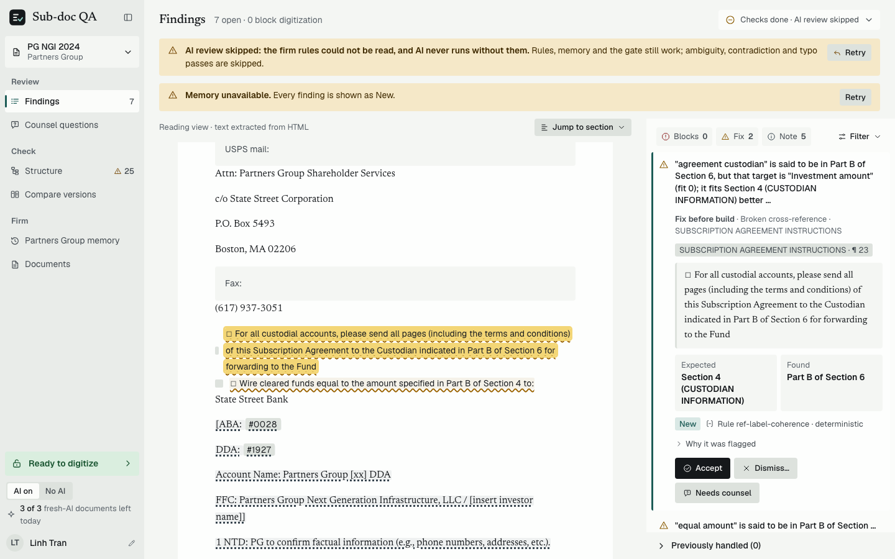
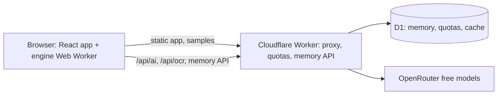
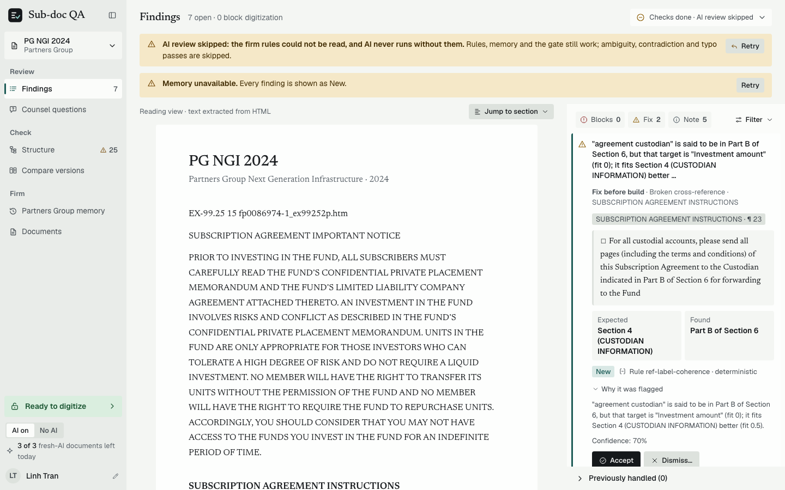
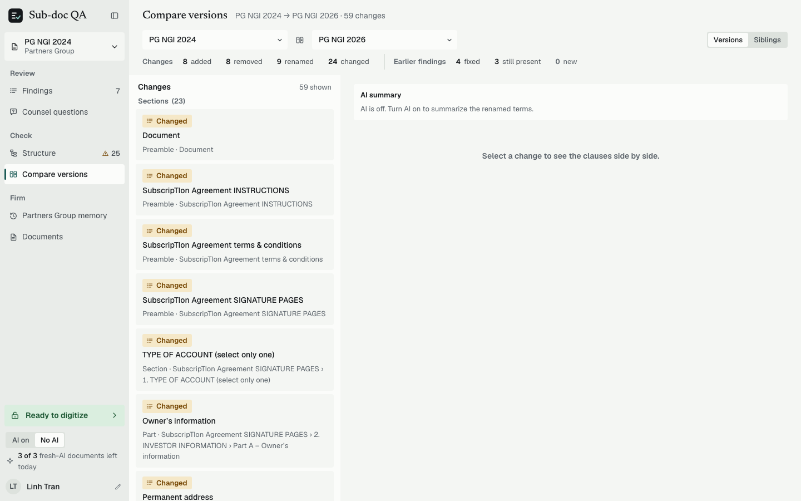
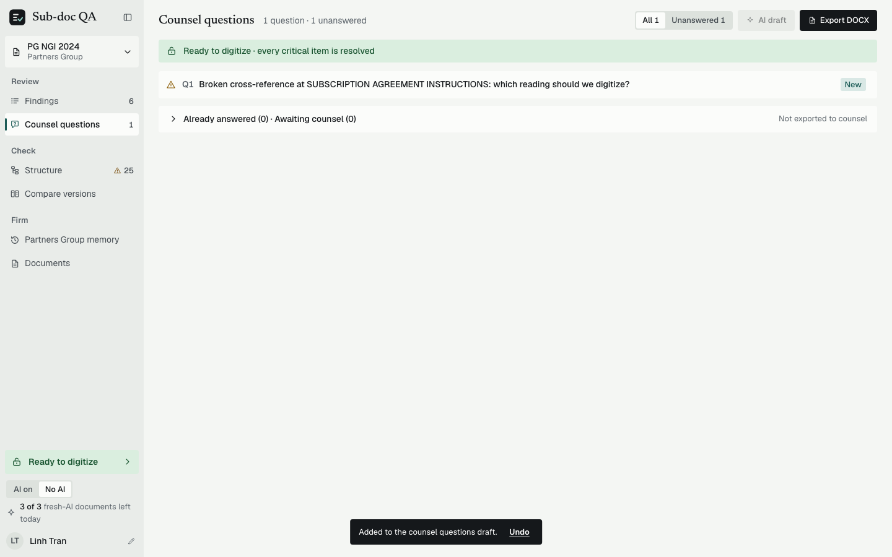
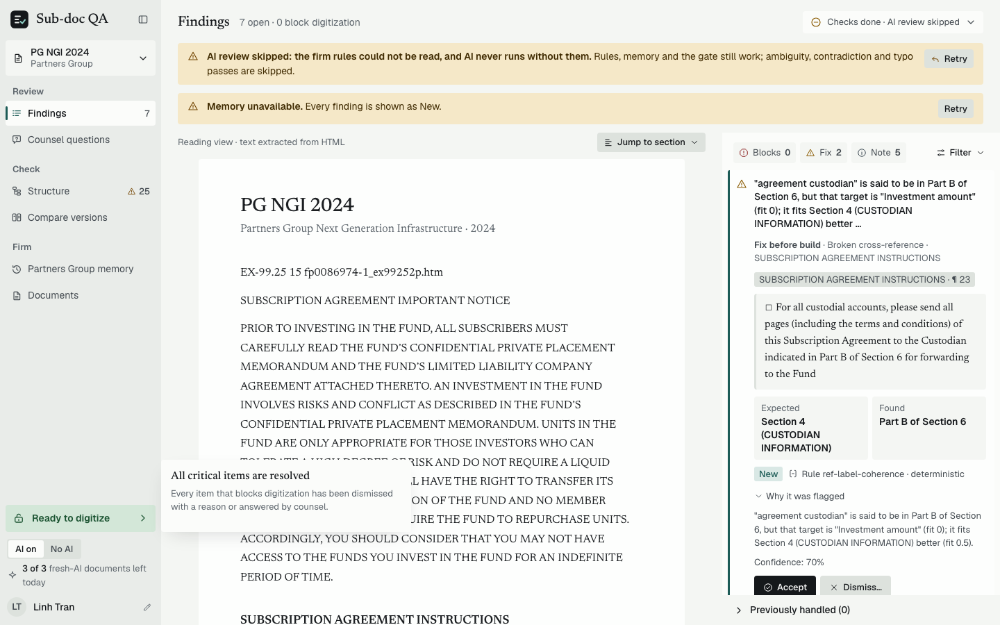

# Subscription Document QA

**Review a fund subscription document before it is digitized.** A web app for the Anduin Transactions
Digitization Service Analyst: it reads a sub doc (HTML, text PDF, DOCX or scanned pages), builds a logic
graph, finds what would break a digitized form, and turns confirmed issues into a counsel query sheet
that blocks digitization until the critical items are answered.

[Live demo](https://aduin-transaction-web.giathaowork.workers.dev) · [Docs](docs/README.md) · [Architecture](docs/architecture/README.md) · [Decisions](docs/architecture/decisions.md)




Live version 23612b12-51c7-4d75-a324-f4f2f6392ba8 (code af59da6) · status: D1 `aduin-transaction-db` is live (schema v5, demo seed of 3 law firms, 1 workspace, 3 firm rules, 8 decisions), the Turnstile managed widget is live, and CSP is enforced (`style-src` keeps `unsafe-inline` for Radix). The zero-upstream smoke run passed.

## At a glance

|                        |                                                                                                                                                                                                                  |
| ---------------------- | ---------------------------------------------------------------------------------------------------------------------------------------------------------------------------------------------------------------- |
| **Problem**            | Errors in a subscription agreement (dead cross-references, wrong conditional skips, unreachable sections, undefined terms) carry into the digital form; finding them by hand across versions is slow and uneven. |
| **Approach**           | Parse in the browser to a logic graph, run 13 deterministic detectors covering 15 issue classes, diff related versions, and turn confirmed issues into a counsel query sheet with a digitization gate.           |
| **What AI does**       | Free OpenRouter models judge graph-selected clause neighborhoods (ambiguity, contradiction, meaning-changing typos) and read scanned pages (OCR).                                                                |
| **What AI never does** | See whole documents, parse, override a deterministic finding, or run without a quotable, locatable citation. The app works with AI switched off.                                                                 |
| **Status**             | Live on Cloudflare Workers with D1 and Turnstile. Largest sample reviews in 169 ms, a ~50 KB sample in 104 ms. Live AI/OCR calls 0, cost $0. Known misses are listed below.                                      |

## Contents

- [At a glance](#at-a-glance)
- [Architecture](#architecture)
- [Screenshots](#screenshots)
- [What and why](#what-and-why)
- [Quick tour](#quick-tour)
- [How it works](#how-it-works)
- [Documentation](#documentation)
- [Run it locally](#run-it-locally)
- [Tests and gates](#tests-and-gates)
- [Cost and limits](#cost-and-limits)
- [Privacy and retention](#privacy-and-retention)
- [Known misses](#known-misses)
- [Not built for production](#not-built-for-production)
- [Deploy](#deploy)
- [Third-party notices](#third-party-notices)

## Architecture



Parsing and checks run in the browser; the Worker never parses documents. Detail: [docs/architecture/README.md](docs/architecture/README.md).

## Screenshots

|                                                                                       |                                                                                      |
| ------------------------------------------------------------------------------------- | ------------------------------------------------------------------------------------ |
|  |    |
| Every finding cites the document text and its location.                               | Compare related versions: drift rows with a short narrative.                         |
|                               |  |
| Confirmed issues become counsel questions, exportable as DOCX.                        | The gate stays blocked until every blocking question has an answer.                  |

Full shot list: `docs/demo/storyboard.md`.

## What and why

Before Anduin turns a subscription agreement into an online form, an analyst reads it for errors that
would carry into the digital flow: a cross-reference that points nowhere, a conditional that skips the
wrong section, a section no investor can reach, a defined term used but never defined. Doing that by hand
across a 40-page document, and again for every feeder, parallel and prior version, is slow and uneven.
This tool does the mechanical part deterministically and shows its evidence, then lets the analyst triage.

## Quick tour

1. Open the live site and pick **sample 5** (Partners Group NGI 2024). Findings opens with the document on the
   left and findings on the right. Each row shows a rule id or a model label, plus the quoted evidence.
2. Triage with the keyboard: accept, dismiss (a reason is required) or send to counsel. Severity is always an
   icon plus a word, never color alone.
3. **Compare versions**: compare sample 5 against sample 6. Drift rows appear with a short AI narrative
   (precomputed on the live samples).
4. **Counsel questions**: confirmed items become questions. Export the sheet as DOCX. The gate pill reads
   "Blocked · N" until every blocking question has an answer.
5. **Structure** shows the section tree, cross-reference graph and investor-type paths. The logic outline
   exports as JSON.
6. **Firm memory** remembers earlier decisions for a law firm and proposes a rule after three matching
   dismissals. Reach it from the sidebar (a direct `#memory` link lands on Findings on first load by design:
   routes are never persisted). Memory is shared and writable on the live site (D1 is live), behind the visitor session and Turnstile.

Screenshots: `docs/demo/img/` (captured from the live site; shot list in `docs/demo/storyboard.md`). Video and slides: `docs/demo/`.

## How it works

- **Deterministic first, LLM second.** The engine in `packages/core` parses to a logic graph and runs
  **13 detectors covering 15 issue classes**: 11 classes come from the detectors, 3 are AI-only
  (`logic_contradiction`, `ambiguity`, `meaningful_typo`) and 1 comes from version diff (`version_drift`).
  The detector count is read from `packages/core/src/detectors/registry.ts`. Every finding cites clause text and
  location. The app works with AI switched off.
- **LLMs only judge.** Free OpenRouter models see graph-selected clause neighborhoods, never whole documents.
  Output is schema-checked, and quotes must be locatable in the document or the finding is dropped.
  Results are cached by content hash.
- **Browser does the parsing.** The Cloudflare Worker (`apps/worker`) serves the SPA and proxies AI and OCR calls
  with quotas, a spend cap and a circuit breaker. It never parses documents.
- **Memory.** A D1 database holds firm memory, decisions, counsel answers and rules (snippets, hashes and metadata
  only, no full documents).

| Package         | Role                                                                                  |
| --------------- | ------------------------------------------------------------------------------------- |
| `packages/core` | Parser, graph, detectors, findings, diff, LLM task framework, frozen contracts        |
| `apps/web`      | React 19 + Vite + Tailwind SPA; the engine runs in a Web Worker                       |
| `apps/worker`   | Cloudflare Worker: static assets, `/api/ai`, `/api/ocr`, `/api/quota`, memory API, D1 |
| `scripts`       | Guards, sample builder, live and conformance probes, deploy helpers                   |

Detail: [docs/architecture/README.md](docs/architecture/README.md).

## Documentation

- [docs/README.md](docs/README.md): reviewer's reading paths by time budget
- [docs/architecture/README.md](docs/architecture/README.md): architecture overview, workflows, components, data model, decisions, status
- [docs/DEPLOY.md](docs/DEPLOY.md): deploy, rollback and live checks
- [docs/demo/](docs/demo/): narration script, storyboard and slides
- [samples/sub-docs/README.md](samples/sub-docs/README.md): the real public SEC sub docs used as test inputs

## Run it locally

<details>
<summary>Requirements and commands (Node 24+, pnpm 11)</summary>

Requires Node 24 or newer and pnpm 11.

```bash
pnpm install
pnpm --filter @aduin/web dev          # SPA only, no AI
pnpm dev:stack                        # build the SPA and run the Worker locally (wrangler dev)
```

Secrets stay outside the repo. For local AI, put `OPENROUTER_API_KEY` in the gitignored `apps/worker/.dev.vars`.

</details>

## Tests and gates

<details>
<summary>Gate commands and final counts (core 2,914, worker 525, web unit 223, scripts 150, e2e 173, stack-memory 10)</summary>

| Gate                                  | Command                                                                                                                              |
| ------------------------------------- | ------------------------------------------------------------------------------------------------------------------------------------ |
| Core (unit, golden, property, seeded) | `pnpm --filter @aduin/core test`                                                                                                     |
| Worker (Vitest with local D1)         | `pnpm --filter @aduin/worker test`                                                                                                   |
| Web unit                              | `pnpm --filter @aduin/web test`                                                                                                      |
| Typecheck and lint                    | `pnpm typecheck` and `pnpm lint`                                                                                                     |
| Browser (preview project)             | `pnpm --filter @aduin/web test:e2e`                                                                                                  |
| Accessibility (axe)                   | `pnpm --filter @aduin/web test:a11y`                                                                                                 |
| Stack with memory                     | `pnpm --filter @aduin/web test:e2e:stack-memory`                                                                                     |
| Live smoke                            | `SLICE_BASE_URL=https://aduin-transaction-web.giathaowork.workers.dev pnpm --filter @aduin/web exec playwright test --project=stack` |
| Safety guards                         | `pnpm guard:cf` and `pnpm secrets:scan`                                                                                              |

There is no CI pipeline; every gate runs locally. Final counts: core 2,914, worker 525, web unit 223, scripts 150,
preview e2e 173 passed plus 1 opt-in skip, stack-memory 10. The tool has 13 detectors covering 15 issue classes.

</details>

## Cost and limits

- Free OpenRouter models only. The paid fallback is disabled in code and a circuit breaker trips on any non-free
  model or any billed usage. The text model is `nvidia/nemotron-3-super-120b-a12b:free`.
- Per visitor per UTC day: 3 fresh-AI documents, 8 AI requests, 6 OCR pages. A global daily provider allowance caps
  everything else. Bundled samples use precomputed AI and OCR results and make zero upstream calls.
- Hosted on Cloudflare Workers Free with D1 Free; the binding limit is D1 `rows_written` (100k per day), handled by
  write caps that refuse rather than overspend. Remote baseline measured at 238 `rows_written` for the day (migrations plus seed); the burst test was not run.

## Privacy and retention

- Documents are parsed in the browser. Only clause neighborhoods (AI) or page images (OCR, only while AI review is on)
  are sent to a third-party free model, after an in-app disclosure. Sensitive spans are masked before sending.
- The database stores snippets, hashes and metadata, never full documents. Sandbox workspaces are purged after
  30 days, quota counters after 2 days, AI cache after 7 days (daily cron).
- Free models can log prompts; do not upload real investor data to the demo.

## Known misses

<details>
<summary>What the tool does not do or gets wrong today (structurer, citations, compare, live AI, Turnstile, CPU, burst)</summary>

Honest list of what the tool does not do or gets wrong today.

- **Structurer misses (P6-1a):** sample 02 accepts zero sections (duplicated application text); sample 12
  sections 4 and 6 are not accepted though headings exist; sample 01 "14." is not accepted.
- **Statutory cite misses (P6-1b):** some statutory or external references are classed internal or out of range
  (for example "Sections 311" of the Patriot Act, a typo'd "Section 2O2(a)(22)", "18 U.S.C. Sections 1956").
- **Sub-letter references (P6-1c):** "Section 4B / 3A / 3C" (Part B of a section) are not resolved to parts.
- **Single-other-scope fallback (P6-1d):** `resolveScope` may hide false negatives on samples 03-06.
- **Missing-target cross-reference detector** is not built: feasibility on the corpus was inconclusive.
- **Compare cannot diff scanned (OCR) documents**, and diff-only rows cannot become counsel questions.
- **Edit of finding text or severity (B-EDIT)** is not built; you can accept, dismiss or send to counsel.
- **Live AI quality is unproven at scale:** one capped live sweep only; counsel drafts and drift narratives
  were not measured against a human. OCR ground truth was transcribed by an agent and live OCR confidence is flat.
  The live AI sweep was not run in Phase 10: automated browsers cannot get a Turnstile token. Samples 1 and 3 have
  precomputed AI and recorded results; a human-operator live run is still pending and is a known miss.
- **Automated browsers cannot get a Turnstile token**, so live AI and OCR from CI or scripts is untested.
- **Worker CPU p99 was 16 ms**, above the 10 ms Free limit, with 0 errors observed (p50 1.6 ms).
- **D4 burst (rows_written under load) was not measured.**
- Investor-path detectors have no human-checked ground truth. The `#documents` screen is still a placeholder.

</details>

## Not built for production

<details>
<summary>No accounts, no CI, no tenant isolation, no paid-model path</summary>

No accounts or real authentication (visitor cookie plus Turnstile), no CI, no tenant isolation beyond the sandbox
workspace model, no paid-model path, no audit export beyond the in-app trail, and no support for documents over the
upload limits. This is a challenge build, not a product.

</details>

## Deploy

See [docs/DEPLOY.md](docs/DEPLOY.md). Deploys go to `*.workers.dev` only.

## Third-party notices

<details>
<summary>Dependency licenses and test-document sources</summary>

Licenses of every direct dependency, the transitive license elections (sax BlueOak-1.0.0, pako, jszip under MIT) and the
dev-only MPL-2.0 exception are in [THIRD_PARTY_NOTICES.md](THIRD_PARTY_NOTICES.md). Test documents are real public SEC
filings, listed with their known defects in [samples/sub-docs/README.md](samples/sub-docs/README.md).

</details>
