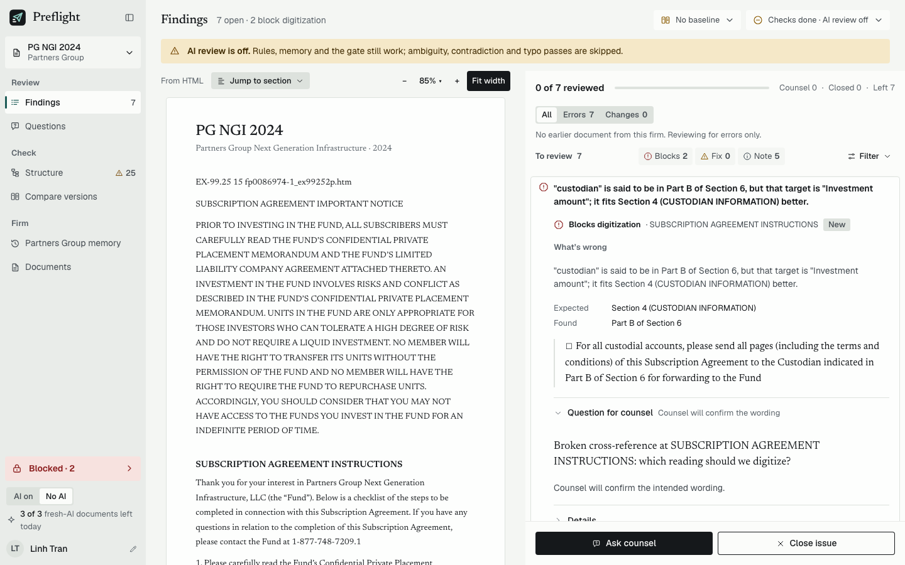
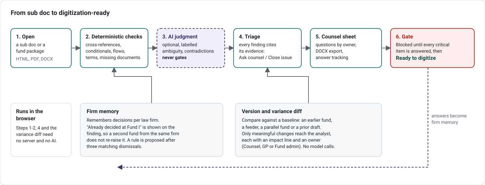
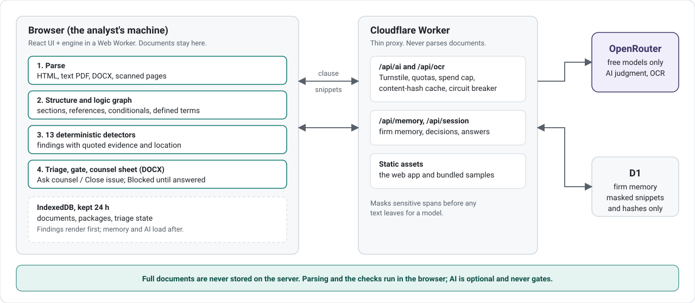
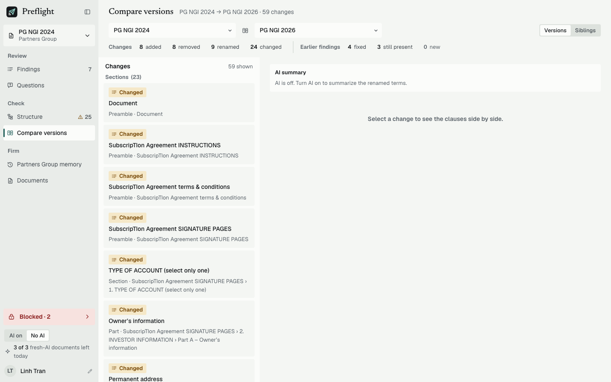

# Preflight: Subscription Document QA

**Anduin Transactions challenge: review legal agreements before digitization**

**Check a fund subscription document before it is digitized.** A web app for the Anduin Transactions Digitization Service Analyst. It reads a sub doc (HTML, text PDF, DOCX or scanned pages), builds a logic graph, flags what would break a digitized form, and turns confirmed issues into a counsel question sheet. A gate stays **Blocked** until every critical question is answered. It also takes a whole fund package (sub agreement, LPA, PPM, baseline, side letters), says which cited documents are missing and drafts one request to the GP.

Built by Thao Dao for the Anduin Transactions job-application challenge. [LinkedIn](https://www.linkedin.com/in/thaodao0912/) · [Website](https://itsjiathao.com/)

**[Open the live demo](https://preflight-legal-reviewer.giathaowork.workers.dev)** · [Docs](docs/README.md) · [Architecture](docs/architecture/README.md)



## What it does for an analyst

1. **Open** a sub doc or a fund package (several files of one fund).
2. **Deterministic checks** flag broken cross-references, broken conditional skips, unreachable sections, investor-type gaps, defined-term issues and missing package documents. Each finding quotes the document and says where.
3. **Optional AI judgment** (ambiguity, contradictions, meaning-changing typos) is labelled as AI, must quote locatable text, and never gates.
4. **Triage** each finding: **Ask counsel** or **Close issue** (a reason is required).
5. **Counsel question sheet** (DOCX, grouped by owner: Counsel, GP, Fund admin) with answer tracking.
6. **Digitization gate**: Blocked until every critical item is answered, then Ready.
7. **Firm memory** remembers decisions per law firm, so a second fund from the same firm does not re-raise what was already decided.
8. **Variance diff** against a baseline (earlier fund, feeder, parallel or prior draft) shows only meaningful changes, each with an impact line and an owner.

<details>
<summary><b>The 13 deterministic detectors</b> (no AI; source: <code>packages/core/src/detectors/</code>)</summary>

| #   | Detector                     | What it catches                                                                                                              | Default severity                              |
| --- | ---------------------------- | ---------------------------------------------------------------------------------------------------------------------------- | --------------------------------------------- |
| 1   | `ref-this-section`           | "this Section N" where N is not the section it sits in                                                                       | Critical in a routing context, otherwise high |
| 2   | `ref-label-coherence`        | A reference whose label does not fit the cited target but fits another (e.g. swapped "Part B of Section 6")                  | Critical in a routing context, otherwise high |
| 3   | `broken-conditional`         | "If ..., complete / skip / proceed to Section N" where the target section, part, annex or question does not exist            | Critical                                      |
| 4   | `unreachable-flow`           | Jump instructions that form a cycle or leave a section unreachable                                                           | Critical                                      |
| 5   | `investor-path-dead-end`     | An investor type whose path never reaches the signature page                                                                 | Critical                                      |
| 6   | `investor-path-missing-item` | A required item missing from an investor type's path (e.g. told to "also complete Part C", but Part C is missing or skipped) | High                                          |
| 7   | `option-gap-overlap`         | Option groups with numeric gaps or overlaps, or "check one" groups that offer "All of the above"                             | High                                          |
| 8   | `footnote-requirement`       | Options in one group that carry footnote requirements inconsistently                                                         | High                                          |
| 9   | `defined-term-issues`        | The same term defined twice, or used before its definition                                                                   | High / medium                                 |
| 10  | `undefined-term`             | An offering-security noun (e.g. "Units" where the document defines "Shares") that is never defined                           | Medium                                        |
| 11  | `flag-drafting-note`         | Internal drafting notes left in ("NTD:", "Note to draft")                                                                    | Medium                                        |
| 12  | `flag-placeholder`           | Unfilled placeholders such as `[xx]`, `[insert ...]`, `[●]`                                                                  | Medium                                        |
| 13  | `flag-sensitive`             | Bank account and routing numbers after a cue word (ABA, DDA, account), masked to the last 4 digits                           | Medium                                        |

"Routing context" means the reference sits in instructions, an answer option or a conditional, where a wrong target would send the investor to the wrong place. These 13 detectors cover 11 issue classes. The other 4 classes are AI-only judgment (logic contradiction, ambiguity, meaningful typo) and version drift from the diff.

</details>



## Expected outcome: less work

Counts below are measured on the bundled samples and demo packages. Nothing was timed with real analysts, so any time saving is an estimate and is not claimed here.

| Measure                                                   | Result                                                                                   | Source                                                                                                              |
| --------------------------------------------------------- | ---------------------------------------------------------------------------------------- | ------------------------------------------------------------------------------------------------------------------- |
| Fund II reviewed after Fund I with firm memory            | 8 findings, 5 already handled by memory, 3 need action: **62.5% fewer to review**        | `process/general-plans/active/subdoc-qa-mvp_17-10-26/subdoc-qa-mvp_PHASE-10-deploy-final_REPORT_17-10-26.md` (AC59) |
| Variance demo (Hartwell & Crane Fund III against Fund II) | 214 raw text changes, **7 shown** (3 new, 4 logic); 207 cosmetic hidden and grouped      | `process/features/variance-management/active/variance-mvp_17-10-26/variance-mvp_REPORT_17-10-26.md` (V4)            |
| Speed of the checks (in the browser)                      | 379 KB sample in 169 ms; 50 KB sample in 104 ms; six-file package to findings in ~229 ms | Phase 10 report above; live smoke in `docs/architecture/status.md`                                                  |
| Detectors and issue classes                               | 13 detectors, 15 issue classes (11 deterministic, 3 AI-only, 1 from version diff)        | `packages/core/src/detectors/registry.ts`, `packages/core/src/findings/taxonomy.ts`                                 |

What this replaces, by design:

- Manual cross-reference tracing across a 40-page document, repeated for every version.
- Hand-written query emails to counsel: the sheet is generated from confirmed findings.
- Re-reviewing the same template points on a firm's next fund: memory and variance carry them over.
- Digitizing with an unresolved critical issue: the gate blocks it.

## How it was built

- **Browser-first.** Parsing and checks run in the user's browser in a Web Worker. Full documents are never stored on the server.
- **Deterministic first, LLM second.** The LLM only sees clause neighborhoods picked from the graph and cannot override a deterministic finding. The app works with AI off.
- **Thin backend.** A Cloudflare Worker proxies AI and OCR (quotas, Turnstile, spend cap, content-hash cache) and serves the firm memory API on D1.
- **Free models only**, with caching and daily quotas. Live AI and OCR cost: $0.
- **Phased, spec-driven build** with tests at every phase (see Tests).



## How the technical flow works

1. **Upload and parse** in the browser: HTML, text PDF (unpdf), DOCX (mammoth) or scanned pages (OCR through the Worker).
2. **Line stream** of the document text with locations.
3. **Structurer** finds sections, cross-references, conditionals and defined terms.
4. **Logic graph** of sections, references and investor-type paths.
5. **Detectors** run on the graph and emit **findings with evidence** (quote plus location).
6. **Findings render first.** Memory and AI load after, so the analyst never waits on them.
7. **Optional AI pass** on graph-selected candidates: Turnstile-gated, cached by content hash, free model, output schema-checked, quotes must be locatable or the finding is dropped.
8. **Memory lookup** by fingerprint. The server receives only masked snippets and hashes.
9. **Triage, gate and counsel sheet** in the browser. Retention: documents and packages stay in the browser for 24 h.

## Tech stack

| Layer   | What                                                                                                                                   |
| ------- | -------------------------------------------------------------------------------------------------------------------------------------- |
| Engine  | TypeScript 6 (ESM), htmlparser2 12, unpdf 1.9, mammoth 1.13, diff 9, zod 4.6, @noble/hashes 2.4 (`packages/core`)                      |
| Web     | React 19.3, Vite 8, Tailwind 4, Zustand 5, Dexie 4 (IndexedDB), Comlink 4 (Web Worker), Radix dialog and popover, pdfjs-dist 6, docx 9 |
| Backend | Cloudflare Workers (wrangler 4), D1, Turnstile, OpenRouter free models (`nvidia/nemotron-3-super-120b-a12b:free` for text)             |
| Testing | Vitest 4 (with the Cloudflare vitest plugin for the Worker), Playwright 1.64, fast-check 4, axe-core                                   |
| Tooling | pnpm 11 monorepo (`packages/core`, `apps/web`, `apps/worker`, `scripts`), eslint 10, prettier 3.9                                      |

## Try it

1. Open the [live demo](https://preflight-legal-reviewer.giathaowork.workers.dev) and pick **sample 5** (Partners Group NGI 2024). The gate pill reads **Blocked · 2** (samples 3 and 5 both block). Open a finding to see the quoted evidence, then use **Ask counsel** or **Close issue**.
2. **Questions** shows the counsel sheet and the DOCX export. The pill stays Blocked until blocking questions have answers.
3. **Compare versions**: sample 5 (PG NGI 2024) against sample 6 (PG NGI 2026) for the drift rows.
4. **Fund package**: Open a document, then the demo package **Northgate Capital III** (6 files). Confirm each file's type and role, run checks, and read the coverage line and the **For the GP** questions.
5. **Firm memory** is in the sidebar. A direct `#memory` link lands on Findings by design, because routes are not persisted.

AI review needs a quick human verification (Turnstile) and the free model takes about 3 to 4 minutes (one measured run: 178 s). Bundled samples have precomputed AI results and make no upstream calls. The Variance demo (214 to 7) needs a memory session: upload Fund II, then Fund III, both tagged Hartwell & Crane LLP, and choose the **Changes** segment. Walkthrough: [docs/walkthrough/demo-walkthrough.vi.md](docs/walkthrough/demo-walkthrough.vi.md) (Vietnamese).



## Run locally

Node 24+ and pnpm 11.

```bash
pnpm install
pnpm --filter @aduin/web dev    # SPA only, no AI
pnpm dev:stack                  # SPA plus the Worker locally (wrangler dev)
```

For local AI, put `OPENROUTER_API_KEY` in the gitignored `apps/worker/.dev.vars`. Deploy and rollback: [docs/DEPLOY.md](docs/DEPLOY.md).

## Tests

There is no CI pipeline; every gate runs locally. Counts as of 18-10-26 (Findings v2 closeout; core, worker and scripts counts from the Variance closeout): core 3,190, worker 608, web unit 544, scripts 183, browser e2e 253 (plus 1 opt-in skip), stack-memory e2e 12.

| Gate                          | Command                                                             |
| ----------------------------- | ------------------------------------------------------------------- |
| Core (unit, golden, property) | `pnpm --filter @aduin/core test`                                    |
| Worker (local D1)             | `pnpm --filter @aduin/worker test`                                  |
| Web unit                      | `pnpm --filter @aduin/web test`                                     |
| Browser e2e                   | `pnpm --filter @aduin/web test:e2e`                                 |
| Accessibility (axe)           | `pnpm --filter @aduin/web test:a11y`                                |
| Stack with memory             | `pnpm --filter @aduin/web test:e2e:stack-memory`                    |
| Types, lint, safety guards    | `pnpm typecheck`, `pnpm lint`, `pnpm guard:cf`, `pnpm secrets:scan` |

Pass test file names as separate commands, not after a `--`. Live version: Worker `493f2501-8920-43b5-95fd-e0878877ab1f` (Findings v2 on top of Variance, D1 schema 6); see `process/context/worker/all-worker.md`.

## Known limits

- **Turnstile and AI:** live AI and OCR need a Turnstile token. Automated browsers get one only sometimes, so scripted live AI runs are not reliable. The free model is slow (minutes per document) and its quality is unproven at scale.
- **Structurer misses:** some heading styles are not recognized (for example sample 02 has no accepted sections; sample 12 sections 4 and 6). Some statutory citations and sub-letter references ("Section 4B") are misclassified.
- **Package intake:** some references and cross-document terms are missed (on the Lotus Bay demo package 2 of 3 GP requests are produced). Two sub agreements in one package need the analyst to pick roles. Type detection is rule-based only.
- **Compare** cannot diff scanned (OCR) documents. Editing a finding's text or severity is not built.
- **Variance:** digit changes in operative text count as logic, so demo package 01 shows 9 change rows rather than the answer key's 7.
- **Demo data:** public SEC documents and synthetic fund packages only. Free models can log prompts, so do not upload real investor data.
- **Not built for production:** accounts or SSO, tenant isolation beyond the sandbox workspace, a zero-retention LLM provider, a paid-model path, CI.

Full lists with backlog pointers: [docs/architecture/status.md](docs/architecture/status.md).

## Documentation

- [docs/README.md](docs/README.md): reading paths by time budget
- [docs/architecture/README.md](docs/architecture/README.md), with [workflows](docs/architecture/workflows.md), [components](docs/architecture/components.md), [data model](docs/architecture/data-model.md), [decisions](docs/architecture/decisions.md) and [status](docs/architecture/status.md)
- [docs/DEPLOY.md](docs/DEPLOY.md): deploy, rollback, live checks
- [docs/demo/](docs/demo/): [script](docs/demo/script.md), [storyboard](docs/demo/storyboard.md), [slides](docs/demo/slides.html)
- <!-- DRIVE_LINK --> Demo video and slides: (link coming)
- [samples/sub-docs/README.md](samples/sub-docs/README.md) and [samples/packages/README.md](samples/packages/README.md): test inputs with known defects
- [design/mockups/](design/mockups/): approved mockups
- [THIRD_PARTY_NOTICES.md](THIRD_PARTY_NOTICES.md): dependency licenses

## Author

Thao Dao, [LinkedIn](https://www.linkedin.com/in/thaodao0912/) · [website](https://itsjiathao.com/).
