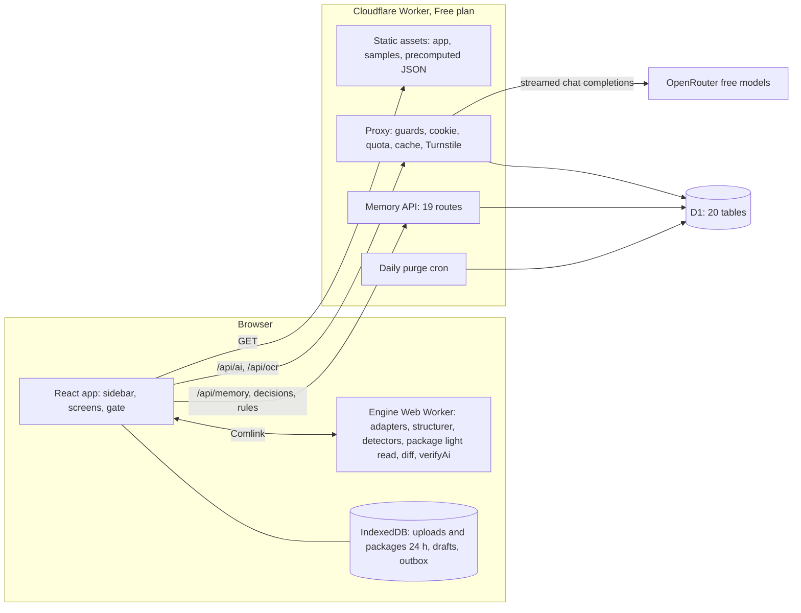

# Architecture overview

A browser-first QA tool for fund subscription documents. All parsing and checks run in the visitor's browser; a thin Cloudflare Worker guards AI, OCR and a small memory database. Status key: **Built / Partial / Planned / Not live yet**.

## The problem

Anduin Transactions digitizes fund subscription documents (sub docs) into online forms. Before digitization, an analyst must find typos, broken cross-references, broken skip instructions, unreachable sections, investor-type gaps and defined-term errors, then confirm unclear items with the law firm's counsel. A sub doc rarely stands alone: it cites an LPA, a PPM, annexes, side letters and tax forms. Fund Package Intake reads those documents together, so a term defined in the LPA is not flagged and a document that is missing is requested from the GP. Today this is manual. This app does the review: it parses a document into a logic graph, runs deterministic checks, uses an LLM only to judge a few graph-selected passages, compares related versions, and turns confirmed issues into a counsel query sheet. A gate blocks digitization until every critical item has a clear answer. A firm memory remembers earlier decisions so the same issue is not re-reviewed for the next fund.

## Design principles

| # | Principle | What it means in practice | Where it is enforced |
|---|---|---|---|
| 1 | **Deterministic first, LLM second** | Graph checks are reproducible and explain themselves (rule id plus facts used). The LLM only judges clause neighborhoods that rules selected. The app is fully usable with AI off. | [detectors](../../packages/core/src/detectors/registry.ts), [llm/candidates.ts](../../packages/core/src/llm/candidates.ts) |
| 2 | **AI never gates and must quote real text** | AI findings are labeled "AI suggestion", capped at `high`, and excluded from the gate. A quote that does not exist in the document is dropped and logged. | [verify-quote.ts](../../packages/core/src/llm/verify-quote.ts), [gate.ts](../../packages/core/src/counsel/gate.ts) |
| 3 | **Browser-first parsing, thin Worker** | Adapters, structurer, detectors, diff and gate run in an Engine Web Worker. The Cloudflare Worker never parses a document (server parsing measured at 31-394 ms CPU against a 10 ms Free-plan limit). | [engine.worker.ts](../../apps/web/src/engine/engine.worker.ts), [apps/worker/src](../../apps/worker/src/index.ts) |
| 4 | **Cost discipline** | Free OpenRouter models only ($0 spent). Precomputed results for samples. D1 cache keyed by input, model, prompt, schema and rules hash. Per-visitor and global daily caps. No-LLM mode keeps every deterministic feature. | [limits.ts](../../packages/core/src/config/limits.ts), [cache-key.ts](../../packages/core/src/contracts/cache-key.ts) |
| 5 | **Privacy by construction** | The server memory stores snippets (max 300 chars), hashes and metadata. Full documents stay in the browser (IndexedDB, 24 h). Sensitive numbers are masked to the last 4 digits before they reach any hash or snippet. | [mask.ts](../../packages/core/src/memory/mask.ts), [0002_memory_core.sql](../../apps/worker/migrations/0002_memory_core.sql) |

## Runtime map

The browser holds the engine, the document and, for a fund package, every document of the package (each file gets a light read in the Engine Web Worker; the pure package analysis of type and role, references, cross-document terms, coverage and GP request items then runs in the app state, with no network; packages are stored in IndexedDB). The Worker serves the static app and guards three things: AI/OCR proxy, memory API and a daily purge. It has no package route and D1 has no package table. D1 is the only datastore. OpenRouter is the only external service.

D1 (`aduin-transaction-db`) is bound and live on the deployed Worker (see [status.md](status.md)). The OpenRouter key exists only as a Worker secret.

## What runs where

| Layer | Runs in | Owns | Never does |
|---|---|---|---|
| React app | Browser main thread | Screens, triage, gate display, DOCX export, PDF page rendering for OCR, memory outbox | Parse documents, call OpenRouter |
| Engine Web Worker | Browser worker thread (Comlink) | Format adapters, structurer, logic graph, 13 detectors, light read of each package file (the package analysis itself is pure core code called from the app state), diff, counsel template drafts, quote verification | Network calls |
| IndexedDB (Dexie) | Browser | Uploaded bytes (24 h), packages (24 h), parsed models, drafts, UI state, decision outbox, daily allowance | Long-term storage |
| Static assets | Cloudflare Worker (assets binding) | SPA bundle, 12 HTML samples, the 22-page scan set, precomputed AI/OCR JSON | Dynamic logic |
| Proxy | Cloudflare Worker | Header and body guards, pre-limit, visitor cookie, quota claims, cache read/write, Turnstile, OpenRouter streaming, spend ledger | Parse a document, store a document |
| Memory API | Cloudflare Worker + D1 | Sessions, lookup, runs, decisions, counsel Q&A, rules, audit, export (19 routes) | Fuzzy matching, store full text |
| D1 | Cloudflare | 20 tables: firm memory, AI cache, quota counters, spend ledger | Hold uploaded files |
| Purge cron | Cloudflare Worker (03:17 UTC daily) | Delete expired sandboxes, old cache and quota rows | Touch the demo workspace |
| OpenRouter | External | Free text and vision models (text: `nvidia/nemotron-3-super-120b-a12b:free`, vision: `nvidia/nemotron-3.5-super-vl:free`) | Receive PDFs or full documents |

Lookup order for AI results: static precomputed file, then D1 cache, then a live free-model call.

## Code layout

| Package | Role |
|---|---|
| [packages/core](../../packages/core/src/index.ts) | Pure TypeScript shared by browser and Worker: model, adapters, structurer, graph, detectors, diff, [package intake](../../packages/core/src/package/index.ts), memory fingerprints, counsel gate, LLM task registry, contracts (zod) |
| [apps/web](../../apps/web/src/main.tsx) | React 19 + Vite 8 + Tailwind 4 SPA, Zustand state, Dexie storage |
| [apps/worker](../../apps/worker/src/index.ts) | Cloudflare Worker: hand-rolled route table, proxy pipeline, memory repo, D1 migrations |
| [scripts](../../scripts/src/build-samples.ts) | Sample builder, seeded fixture builder, precompute and record tools, repo guards |

## Read next

| Doc | Content |
|---|---|
| [workflows.md](workflows.md) | Personas and workflows W1-W8 with diagrams |
| [components.md](components.md) | Component table, request flows, Worker routes, detectors, AI prompt registry |
| [data-model.md](data-model.md) | D1 schema, fingerprint formula, retention, browser storage |
| [decisions.md](decisions.md) | Decision log: what was chosen, what was rejected, why |
| [status.md](status.md) | What is built, partial, planned and live today |

## Related

- [docs/README.md](../README.md): start-here index for reviewers
- [product-domain.md](../../process/context/product-domain.md): domain knowledge and defect taxonomy
- [INNOVATE decision summary](../../process/general-plans/active/subdoc-qa-mvp_17-10-26/subdoc-qa-mvp_INNOVATE_17-10-26.md): the original design decision record
