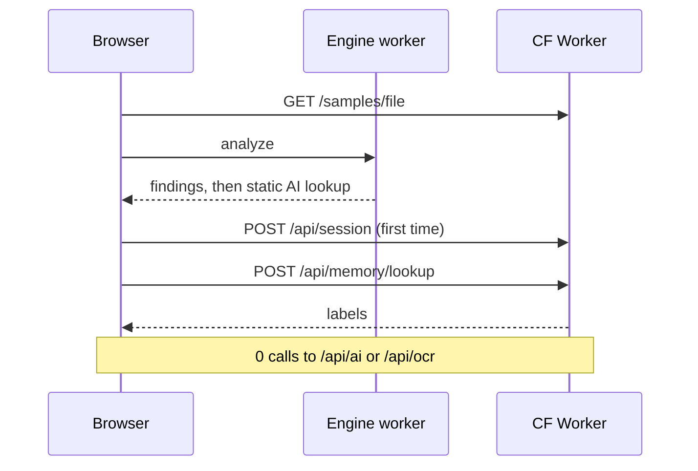
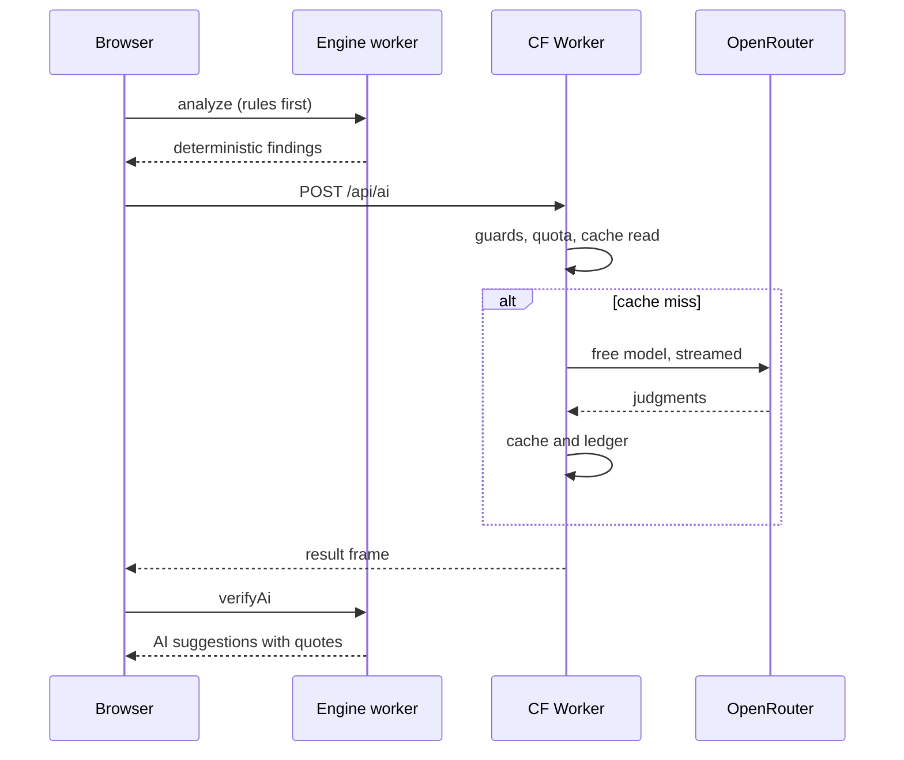

# Components

What each component does, where its code lives, and the request flows, Worker routes, detectors and AI prompts. Paths are relative to the repo root; links go to real files.

## Component table

Status key: **Built / Partial / Planned / Not live yet** (built and tested; live means running on the deployed Worker with real D1 and Turnstile since 17 Oct 2026).

| Component | Responsibility | Tech | Runs in | Key files | Status |
|---|---|---|---|---|---|
| Format adapters | HTML, text PDF, DOCX and OCR JSON into one line stream with positions | htmlparser2, unpdf, mammoth | Engine Web Worker | [adapters](../../packages/core/src/adapters/format-detect.ts) | Built |
| Page render + OCR queue | Render scan pages, check quota, post images one page at a time | pdfjs-dist | Browser main thread | [render-pages.ts](../../apps/web/src/engine/render-pages.ts), [ocr-queue.ts](../../apps/web/src/engine/ocr-queue.ts) | Built |
| Structurer + logic graph | Sections, scoped numbering, references, conditionals, option groups, defined terms | TypeScript, zod | Engine Web Worker | [structure](../../packages/core/src/structure/structurer.ts), [graph](../../packages/core/src/graph/graph.ts), [model](../../packages/core/src/model/types.ts) | Built |
| Detector registry | 13 pure detectors; each finding cites its rule and facts | Pure functions | Engine Web Worker | [detectors](../../packages/core/src/detectors/registry.ts) | Partial (missing-target cross-reference detector deferred) |
| Finding schema | Class, severity, evidence, provenance, masking of sensitive values | zod | Everywhere | [findings](../../packages/core/src/findings/schema.ts), [mask.ts](../../packages/core/src/memory/mask.ts) | Built |
| AI lane | Static lookup, then `/api/ai`; verify quotes; label provenance | zustand, NDJSON stream | Main thread + Web Worker | [features/ai](../../apps/web/src/features/ai/ai-lane.ts), [core/llm](../../packages/core/src/llm/index.ts) | Built |
| Prompt registry | Versioned tasks; versions frozen by test | core llm/tasks | Worker builds, browser verifies | [registry.ts](../../packages/core/src/llm/registry.ts), [models-config.ts](../../apps/worker/src/upstream/models-config.ts) | Built |
| Version diff | Section alignment, word diff, renames, fees, findings delta, sibling mode | jsdiff | Engine Web Worker | [diff](../../packages/core/src/diff/index.ts), [features/compare](../../apps/web/src/features/compare/CompareScreen.tsx) | Built |
| Memory + fingerprint | Normalize quote, fingerprint, label, rules hash, pattern key | @noble/hashes | Browser and Worker (same code) | [core/memory](../../packages/core/src/memory/index.ts) | Built |
| Memory client | Real API client with idempotent outbox and retries | Dexie, fetch | Main thread | [realMemoryApi.ts](../../apps/web/src/api/realMemoryApi.ts), [outbox.ts](../../apps/web/src/api/outbox.ts) | Built |
| Memory API | Session, lookup, runs, decisions, counsel, rules, audit, export | Hand-rolled router, zod | CF Worker + D1 | [routes/memory](../../apps/worker/src/routes/memory/index.ts), [memory/repo](../../apps/worker/src/memory/repo/lookup.ts) | Built; live (real D1 bound) |
| Counsel sheet + gate | Questions, template drafts, gate rules, export metrics | core | Web Worker + main thread | [counsel](../../packages/core/src/counsel/gate.ts), [features/gate](../../apps/web/src/features/gate/gate-store.ts) | Built |
| DOCX export | Export the query sheet | docx (lazy-loaded) | Main thread | [exportDocx.ts](../../apps/web/src/features/counsel/exportDocx.ts) | Built |
| Logic outline export | Versioned JSON of the form logic | zod | Web Worker + main thread | [outline](../../packages/core/src/outline/build.ts), [features/outline](../../apps/web/src/features/outline/ExportOutlineButton.tsx) | Built |
| AI proxy | Guards, pre-limit, masking, cookie, firm rules, cache, Turnstile, claims, streaming with heartbeats, ledger | Hand-rolled pipeline | CF Worker | [proxy](../../apps/worker/src/proxy/pipeline.ts), [routes/proxy](../../apps/worker/src/routes/proxy/index.ts), [upstream](../../apps/worker/src/upstream/openrouter.ts) | Built; AI on uploads is closed on the live site |
| Limits + visitor | Signed visitor cookie, per-visitor and global caps, spend cap, circuit breaker | core config | CF Worker + D1 | [limits](../../apps/worker/src/limits/policy.ts), [platform](../../apps/worker/src/platform/index.ts) | Built; live (D1 quotas) |
| Turnstile | Bot check before fresh AI | Cloudflare Turnstile | Worker verify, browser widget | [turnstile.ts](../../apps/worker/src/identity/turnstile.ts), [turnstile.ts (web)](../../apps/web/src/features/ai/turnstile.ts) | Partial (Worker side built; widget and secret land in Phase 10) |
| D1 schema | 20 tables, migrations 0001-0005, demo seed, write-block triggers | SQLite on D1 | D1 | [migrations](../../apps/worker/migrations/0001_reference_and_workspace.sql), [demo.sql](../../apps/worker/seed/demo.sql) | Built; live (migrations applied remotely, schema 5, demo seed) |
| Static assets | SPA, samples, precomputed AI and OCR | Vite 8, React 19, Tailwind 4 | Workers static assets | [apps/web/public](../../apps/web/public/samples/manifest.json), [apps/web/src](../../apps/web/src/main.tsx) | Built |
| Browser storage | Uploads 24 h, drafts, UI state, outbox | Dexie | IndexedDB | [db.ts](../../apps/web/src/storage/db.ts) | Built |
| Purge cron | Daily purge of expired sandboxes, cache and quota rows | Worker cron 03:17 UTC | CF Worker | [purge.ts](../../apps/worker/src/memory/repo/purge.ts) | Built; live (D1 bound) |
| Scripts + fixtures | Samples, seeded defects, memory fixtures, precompute and record, repo guards, slice check | Node, tsx | Local | [scripts/src](../../scripts/src/build-samples.ts), [fixtures](../../fixtures/cache-key-vectors.json) | Built |
| Final deploy + docs | Real D1, Turnstile, CSP headers, deploy guide, demo materials | wrangler | Cloudflare | [Phase 10 plan](../../process/general-plans/active/subdoc-qa-mvp_17-10-26/subdoc-qa-mvp_PHASE-10-deploy-final_PLAN_17-10-26.md) | Planned |
| CI pipeline | Gates run locally; no workflow files exist | none | none | none | Planned (none today) |

## Request flows

### Opening a bundled sample

Zero AI or OCR calls. Memory is the only network traffic beyond static files.

### Uploading with AI on

Rules run first. AI is added after, verified against the document, and never replaces the deterministic result.

Refund rules in the proxy: refusals before dispatch refund everything; provider-side failures after dispatch refund the visitor's claims but keep the global counter and spend reservation; malformed output and timeouts keep all claims. See the header of [pipeline.ts](../../apps/worker/src/proxy/pipeline.ts).

## Worker routes

One Worker (`aduin-transaction-web`) serves static assets and `/api/*`. `/api/*` runs the Worker first; everything else is the SPA (single-page fallback). The route table is a small hand-rolled matcher in [app.ts](../../apps/worker/src/app.ts), with no web framework.

| Method and path | Group | Purpose |
|---|---|---|
| `GET /api/health` | Platform | Liveness |
| `POST /api/ai` | Proxy | Run a registered AI task on candidates (NDJSON stream) |
| `POST /api/ocr` | Proxy | OCR one scan page (NDJSON stream) |
| `GET /api/quota` | Proxy | Read-only usage and limits for this visitor; never writes |
| `POST /api/session` | Memory | Mint a private sandbox from the demo seed (only route that sets the cookie) |
| `POST /api/memory/lookup` | Memory | Label findings by exact fingerprint match |
| `POST /api/runs` | Memory | Create a review run |
| `POST /api/runs/:id/findings` | Memory | Store findings for a run (best effort) |
| `POST /api/runs/:id/export` | Memory | Record a counsel sheet export |
| `POST /api/decisions` | Memory | Record accept, dismiss or answered |
| `POST /api/decisions/:id/revoke` | Memory | Reopen a decision with a reason |
| `POST /api/counsel/questions` | Memory | Save a counsel question draft |
| `POST /api/counsel/answers` | Memory | Record counsel's A, B, C or unclear |
| `GET /api/rules` | Memory | List firm rules |
| `POST /api/rules` | Memory | Create a manual rule |
| `POST /api/rules/:id/approve` | Memory | Approve a proposal |
| `POST /api/rules/:id/reject` | Memory | Reject a proposal |
| `POST /api/rules/:id/revoke` | Memory | Deactivate a rule |
| `GET /api/memory/firm` | Memory | Firm memory page data (alias: `GET /api/memory/firms/:id`) |
| `GET /api/audit` | Memory | Append-only audit trail |
| `GET /api/export` | Memory | Workspace JSON export |
| `GET /api/memory/health` | Memory | Schema version and demo seed check |

That is 19 memory routes (the alias counts as one), 3 proxy routes and `/api/health`. There is no `/api/cache` route; the cache is internal to the proxy. Memory routes take the workspace from the signed cookie only.

## Detectors

13 deterministic detectors are registered in [registry.ts](../../packages/core/src/detectors/registry.ts), in append-only order. Each is a pure function over the logic graph and emits findings that name the rule and the facts used. Anything the parser cannot prove is ignored, never asserted. The "15" in the product spec is the number of **issue classes**, listed below.

| # | Detector id | Issue class | Max severity | What it finds |
|---|---|---|---|---|
| 1 | `ref-this-section` | broken_cross_reference | high | "this Section N" where N differs from the enclosing section |
| 2 | `ref-label-coherence` | broken_cross_reference | high | A reference whose noun ("the entity documents...") fits another target better than the cited one (swapped Part or Section) |
| 3 | `undefined-term` | defined_term_issue | medium | An offering-security noun used in offering context that differs from the single defined term |
| 4 | `broken-conditional` | broken_conditional | critical | "If..., skip to Section N" where the target does not exist |
| 5 | `unreachable-flow` | unreachable_or_circular_flow | critical | Jump cycles, and sections no route reaches after a universal jump |
| 6 | `option-gap-overlap` | option_gap_overlap | high | Numeric ranges with a gap or overlap; "check one" groups that offer "All of the above" |
| 7 | `defined-term-issues` | defined_term_issue | high | Duplicate, used-before-defined, unused and inconsistent-capitalization terms (rules ported from the MIT defined-terms-checker) |
| 8 | `footnote-requirement` | inconsistent_footnote_requirement | high | Some options carry a footnote marker and sibling options do not |
| 9 | `flag-drafting-note` | drafting_note | medium | Leftover "NTD:" and drafting notes |
| 10 | `flag-placeholder` | placeholder | medium | Unfilled `[xx]`, `[insert ...]` and bullet placeholders |
| 11 | `flag-sensitive` | sensitive_data | medium | Account or routing numbers after a cue word; only the last 4 digits ever leave the detector |
| 12 | `investor-path-dead-end` | investor_path_dead_end | critical | An investor type whose route never reaches the signature |
| 13 | `investor-path-missing-item` | investor_path_missing_item | high | A type told to complete Part C that does not exist, or lacking an item its peers carry |

The 15 issue classes ([taxonomy.ts](../../packages/core/src/findings/taxonomy.ts)):

| Produced by | Classes |
|---|---|
| Deterministic detectors above | broken_cross_reference, broken_conditional, unreachable_or_circular_flow, option_gap_overlap, defined_term_issue, inconsistent_footnote_requirement, drafting_note, placeholder, sensitive_data, investor_path_dead_end, investor_path_missing_item |
| AI only (labeled "AI suggestion", never gates) | logic_contradiction, ambiguity, meaningful_typo |
| Version diff | version_drift |

Not built: a detector for a reference whose target section does not exist at all (feasibility was inconclusive; see [status.md](status.md)).

The counsel gate considers only findings that are `critical` and not AI-detected ([gate.ts](../../packages/core/src/counsel/gate.ts)). Memory's "re-confirm" label applies to `critical` and `high`.

## AI task and prompt registry

The client never sends prompts or picks a model. It sends task id plus candidate ids and quotes; the Worker builds messages from the shared registry in [llm/tasks](../../packages/core/src/llm/registry.ts). Prompt text changes must bump the version, which changes the cache key.

| Task id | Prompt version | Schema version | Input | Output | Used by |
|---|---|---|---|---|---|
| `clause-judgment` | `clause-judgment@1` | `clause-judgment.s1` | Up to 40 graph-selected excerpts | Findings with a verbatim quote, class, severity at most `high`, confidence | W3 AI lane |
| `counsel-draft` | `counsel-draft@1` | `counsel-draft.s1` | Findings needing counsel | One neutral question per excerpt, at most 1500 characters | W4 counsel sheet |
| `drift-narrative` | `drift-narrative@1` | see [drift-narrative.v1.ts](../../packages/core/src/llm/tasks/drift-narrative.v1.ts) | Masked rename pairs from the diff | Plain-language summary; kept only if it names both old and new term | W5 Compare |
| OCR (not in the task registry) | `ocr2` | `s1` | One page image, JPEG | Structured page text with footnote markers | W1 scans |

Common rules: temperature 0, JSON-only output, an untrusted-input notice in every prompt, and a models list that must be `:free` ids (checked on every use by `assertFreeOnly` in [config.ts](../../apps/worker/src/config.ts)). The paid fallback is off (`PAID_FALLBACK_ENABLED=false`). Recorded model responses live in [fixtures/llm-recordings](../../fixtures/llm-recordings/clause-judgment); tests never call a live model.

## Related

- [README.md](README.md): overview and runtime map
- [workflows.md](workflows.md): how users move through these components
- [data-model.md](data-model.md): the tables behind the memory routes
- [decisions.md](decisions.md): why the pieces are split this way
- [status.md](status.md): what is live today
