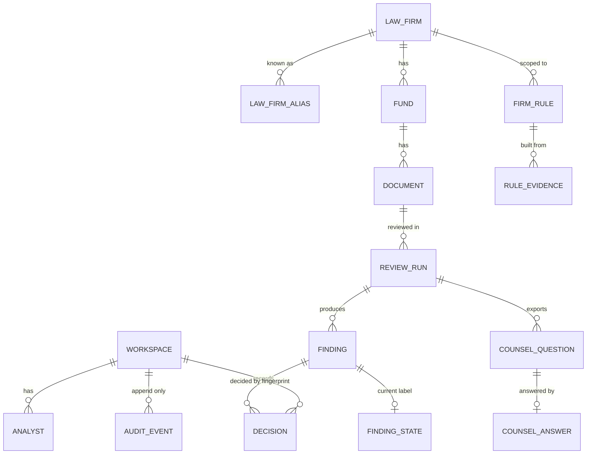

# Data model

The server database (D1) holds snippets, hashes and metadata only, 21 tables across 6 migrations. Full documents stay in the visitor's browser. Source of truth: [apps/worker/migrations](../../apps/worker/migrations/0001_reference_and_workspace.sql).

Status: schema and repository code are **Built** and tested against local D1. The tables are **live**: real D1 `aduin-transaction-db`, schema 6 (migration 0006, Variance, 18 Oct 2026), demo seed, bound to the live Worker (version d9aaddd9; see [status.md](status.md)).

## Entity relationships

The review and memory tables. Every workspace-scoped table uses a composite key `(workspace_id, id)` and composite foreign keys, so a query can never cross workspaces.



Also in D1: `issue_class` (15 codes), `app_meta`, `ai_cache` (keyed by input, model, prompt, schema and rules hash), `quota_counter` and `spend_ledger`. These have no foreign keys to workspaces, so a workspace purge can never delete spend history.

## The 21 tables

| Migration | Table | One line |
|---|---|---|
| 0001 | `app_meta` | Key-value flags: `schema_version`, `seed_mode`, circuit-breaker keys |
| 0001 | `law_firm` | Canonical law firms (id, name) |
| 0001 | `law_firm_alias` | Normalized alias to firm, so "PG" resolves to Partners Group |
| 0001 | `issue_class` | The 15 issue-class codes with label and sort order |
| 0001 | `workspace` | A `demo` (read-only, never expires) or `sandbox` (30-day expiry) workspace |
| 0001 | `analyst` | Display name of an analyst inside a workspace |
| 0001 | `fund` | Fund name under a law firm in a workspace |
| 0001 | `document` | Document metadata: format, content hash, size, pages, version label. Never the content |
| 0001 | `review_run` | One engine run: engine, prompt and schema versions, rules hash, memory mode, AI mode, counts |
| 0002 | `counsel_question` | A question for counsel: draft and edited text (max 2000 chars), status drafted, exported or answered |
| 0002 | `counsel_answer` | Counsel's reply A, B, C or unclear, with note; can be revoked with a reason |
| 0002 | `decision` | Append-only accept, dismiss or answered decision by fingerprint; revoke and supersede chain |
| 0002 | `finding` | Findings of a run (best effort): class, severity, detector id, snippet, hashes, memory label |
| 0002 | `finding_state` | Current triage state per finding: open, accepted, dismissed, answered; needs-counsel flag |
| 0002 | `firm_rule` | A firm rule: proposed, active, rejected or revoked, scoped to one firm |
| 0002 | `rule_evidence` | Links a rule to the decisions that support it |
| 0002 | `audit_event` | Append-only audit trail of every write, with a client operation id for idempotency |
| 0006 | `regression_check` | Append-only R-01 regression check: firm, source answer and fund, assertion (`scope_exists`), statement text, active or revoked |
| 0004 | `ai_cache` | Global AI and OCR result cache, 7-day TTL, hit counter |
| 0004 | `quota_counter` | Atomic daily and per-minute counters for visitors, sessions and global caps |
| 0004 | `spend_ledger` | One row per upstream call: model, tokens, cost in micro-USD (all 0 today), outcome |

Migration 0006 is additive and forward-only: nullable `owner` and `owner_source` on `counsel_question` (counsel, gp, fund_admin; suggested or override), nullable `intent` and `scope` (fund or firm_template) on `counsel_answer` and `decision`, the `regression_check` table, and three reference firms (Hartwell & Crane LLP, Ostrander Pell LLP, Calder Reyes). Because every new column is nullable, an older Worker keeps reading the schema, but 8a82ead2 refuses memory writes after 0006 (it pins schema 5).

Migration 0003 seeds `law_firm`, `law_firm_alias` and `issue_class` (generated by [gen-demo-seed.ts](../../scripts/src/seed/gen-demo-seed.ts)). Migration 0005 adds more demo write-block triggers. [demo.sql](../../apps/worker/seed/demo.sql) is the demo workspace seed.

Integrity enforced in the database, not only in code:

| Rule | Mechanism |
|---|---|
| Decisions, audit events and counsel answers cannot be edited or deleted | Triggers abort the change (delete is allowed only while a sandbox is in `purging` status, which only the purge sets) |
| The demo workspace is read-only | `demo_ro_*` triggers abort writes unless `app_meta.seed_mode = '1'` |
| One active decision per workspace, firm and fingerprint | Partial unique index `uq_decision_active` |
| A dismissal needs a reason; an answered decision needs an option | `CHECK` constraints on `decision` |
| A rule key is live at most once | Partial unique index `uq_rule_proposal` |

## What is stored and what is never stored

| Stored on the server | Never stored on the server |
|---|---|
| Quote snippet, at most 300 characters, masked | The full document text or uploaded file |
| `quote_hash` and `fingerprint` (64 hex characters) | Page images (they are sent to OpenRouter for OCR and not kept; only the OCR JSON result is cached) |
| Section path, class, severity, detector id | Unmasked account or routing numbers (only `#` plus the last 4 digits is kept) |
| Decision, reason code, optional note (500 characters) | The OpenRouter or Turnstile secret (Worker secrets only) |
| Counsel question text (2000 characters) and answer | Raw visitor IP (only a daily-salted hash of the /64 prefix, in the spend ledger and quota keys) |
| Firm rules and their evidence links | Browser-side drafts, parsed models and outbox |
| Cached AI and OCR results (7 days) | Anything for a visitor who never starts a session |

Limits come from one source: [limits.ts](../../packages/core/src/config/limits.ts).

## Fingerprint formula

A finding is recognized by an exact, versioned fingerprint. There is no fuzzy matching: a one-character change in the quote is a new finding, by design.

```text
normalize(q)   = NFC, strip soft hyphen and zero-width chars, lowercase,
                 curly quotes to straight, collapse whitespace, trim
quote_hash     = sha256_hex( normalize(quote) )
fingerprint    = sha256_hex( "fp1|" + firmId + "|" + issueClass + "|" + quote_hash )
rules_hash     = sha256_hex( sorted normalized active rule texts joined by "\n" ), or "none"
cache_key      = sha256_hex( kind|input_hash|model|prompt_ver|schema_ver|rules_hash )
pattern_key    = detectorId[":" shape], digits become "#", at most 80 chars
```

- One implementation in [fingerprint.ts](../../packages/core/src/memory/fingerprint.ts), [normalize.ts](../../packages/core/src/memory/normalize.ts) and [rulesHash.ts](../../packages/core/src/memory/rulesHash.ts), used by the browser for lookups and by the Worker to re-check on writes. Test vectors: [fingerprint-vectors.json](../../fixtures/fingerprint-vectors.json), [cache-key-vectors.json](../../fixtures/cache-key-vectors.json).
- Digits, section numbers and punctuation are kept in `normalize`, so "Section 4" and "Section 5" differ.
- Sensitive spans are masked before hashing ([mask.ts](../../packages/core/src/memory/mask.ts)).
- `fp1` is the version; a change to the formula would bump it.

Memory labels derived from a match ([label.ts](../../packages/core/src/memory/label.ts)):

| Match | Label |
|---|---|
| none, or revoked or superseded | New |
| dismissed, severity below high | Previously handled |
| dismissed, severity critical or high | Re-confirm (stays in the list) |
| answered A, B or C | Already answered |
| accepted, no answer | Awaiting counsel |
| answered `unclear` | New |

## Retention and purge

| Data | Where | Retention |
|---|---|---|
| Uploaded files, parsed models, drafts | Browser IndexedDB | 24 hours |
| Sandbox workspace and all its rows | D1 | 30 days after creation |
| Demo workspace | D1 | Never purged |
| AI and OCR cache | D1 | 7 days (`expires_at`) |
| Quota windows | D1 | Daily windows older than 2 days |
| Spend ledger | D1 | Kept (no foreign keys to workspaces) |

The purge runs lazily when a new session starts (at most once an hour) and from a daily cron at 03:17 UTC ([purge.ts](../../apps/worker/src/memory/repo/purge.ts)). It marks expired sandboxes `purging`, deletes children before parents, then removes expired cache, quota and breaker rows. The demo workspace is never selected.

## Browser storage (IndexedDB)

Database `aduin-web` via Dexie ([db.ts](../../apps/web/src/storage/db.ts)). If IndexedDB is unavailable the app falls back to memory-only.

| Table | Contents | Purged at 24 h |
|---|---|---|
| `documents` | Uploaded bytes plus firm, fund and version label | Yes |
| `parsedModels` | Parsed document model keyed by content hash | Yes |
| `drafts` | Counsel wording drafts | Yes |
| `outbox` | Pending decision writes (idempotent, retried); finished or parked rows are purged | Terminal rows only |
| `uiState` | Sidebar, filters, AI on/off | No |
| `allowance` | Fresh-AI documents used today (display only; the Worker enforces the real quota) | No |
| `decisions` | Local decision rows used by the stub memory API | No |
| `packages` (Dexie v2, additive) | Fund Package Intake: one row per package with firm, fund, version, the primary document, each member's type, role, confidence, reason and confirmed flag, and the confirmed reference targets. Members point at a `documents` row (uploads) or a bundled sample path. `documents` gains a `packageId` index | Yes (24 h) |

### Fund packages are browser-only

A package is stored only in IndexedDB (the `packages` table above, plus the member bytes in `documents`) for 24 hours and is restored on reload. Package intake adds no D1 table, no migration and no Worker route: D1 stays at 20 tables and schema 5 (Variance later added one table, migration 0006, see above). References, cross-document terms, coverage and GP request items are recomputed from the stored members and are never persisted on the server. The GP request is a DOCX built in the browser; nothing about it is written to memory. A stored package row is treated as untrusted input and re-validated on load; a bad row falls back to the single-document path.

## Related

- [components.md](components.md): the routes and repositories that read and write these tables
- [decisions.md](decisions.md): why D1, why exact fingerprints, why no R2 or KV
- [DATA-MODEL doc](../../process/general-plans/active/subdoc-qa-mvp_17-10-26/subdoc-qa-mvp_DATA-MODEL_17-10-26.md): the original design (19 tables at design time; 21 shipped)
- [README.md](README.md): architecture overview
