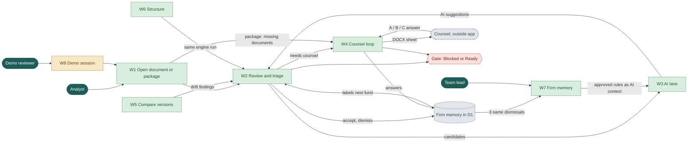
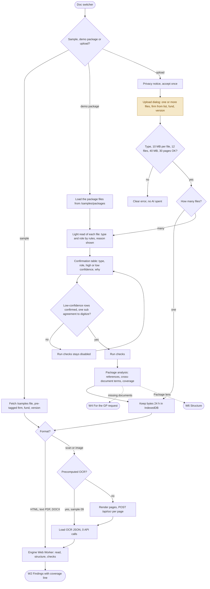
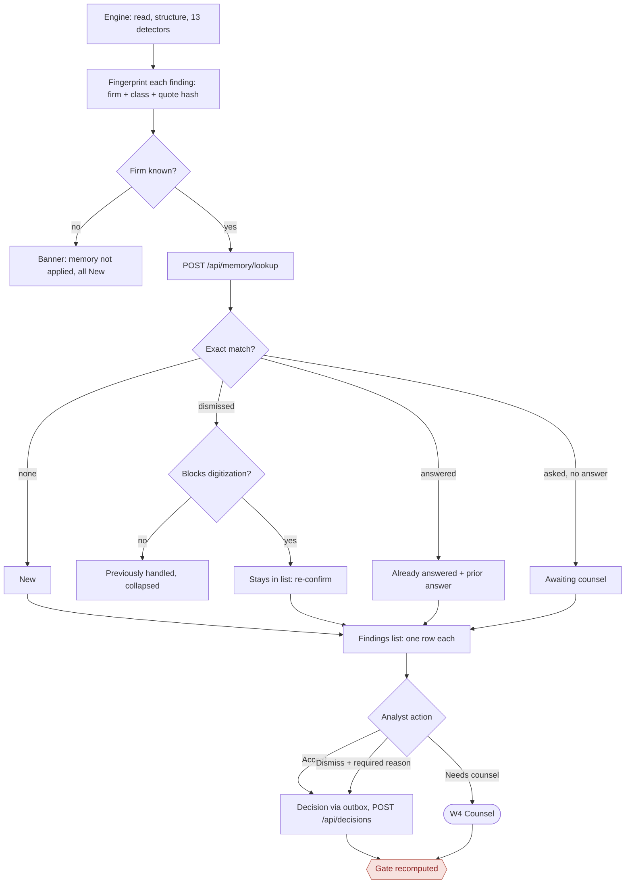
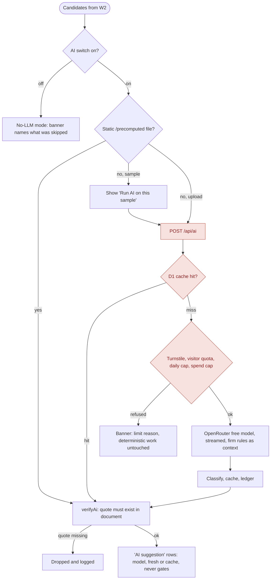
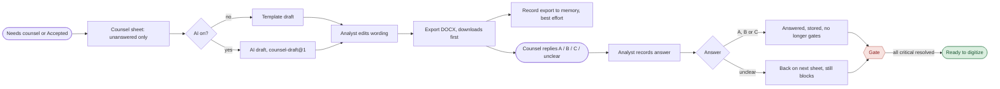
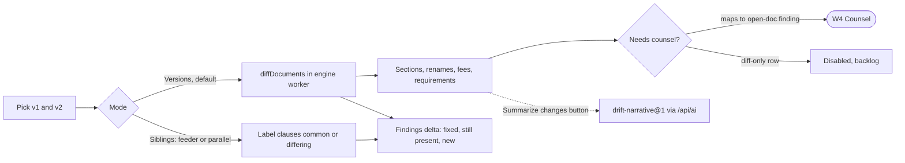
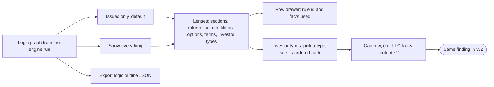
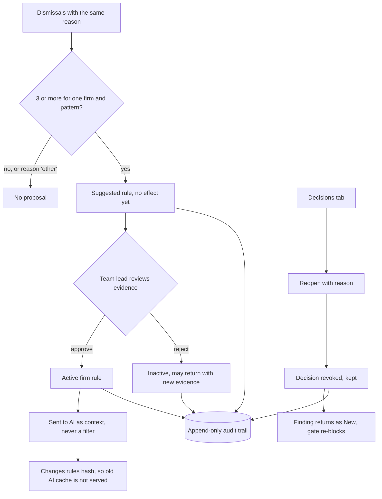
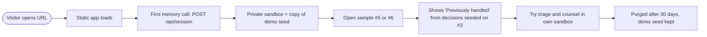

# Workflows and personas

Eight workflows (W1-W8) serve four personas. Each section gives the flow diagram, what it does, its status and the code that implements it.

Status key: **Built** (works on `main` and in the local stack), **Partial**, **Planned**, **Not live yet** (built, but needs the real D1 or Turnstile on the live Worker; see [status.md](status.md)).

## Personas

| Persona | Who | Job in the app | Workflows | Spec refs |
|---|---|---|---|---|
| Digitization analyst | Anduin employee who turns a sub doc into a form | Reviews a document before the form build, triages findings, turns unclear items into counsel questions | W1-W6 | US1-US12, US14-US17, US20-US21 |
| Team lead | Analyst with approval rights | Approves or rejects firm rules the tool proposes, audits who decided what, reopens decisions | W7 | US18, US19, AC53-AC55 |
| Challenge reviewer | The Anduin panel or any anonymous visitor | Tries a sample, sees memory working in a seeded demo, works in a private sandbox | W8 | US13, US22, AC56-AC60 |
| Law-firm counsel | External | Never opens the app. Receives the exported DOCX query sheet by email and replies A, B, C or unclear. The analyst records the reply | W4 only, outside the app | none |

The spec ids refer to the [SPEC](../../process/general-plans/active/subdoc-qa-mvp_17-10-26/subdoc-qa-mvp_SPEC_17-10-26.md).

## Overall workflow map

Two loops matter. Decisions feed memory, which labels the next fund. Counsel answers clear the gate.

Green workflows are built. W8 is amber because the demo session needs D1, which is not bound on the live Worker. The gate reads from both review (W2) and counsel (W4).

## W1. Open a document or a fund package (Partial)

The analyst picks a bundled sample, a demo package, or uploads one or many files. One file takes the classic path. Several files take the package path: each file is typed and given a role, the analyst confirms the uncertain rows, and the package is analyzed before the checks run. Scans take the OCR branch and then join the same engine as every other format.

- Upload checks: type (`.htm .html .pdf .docx .jpg .jpeg .png`), 10 MB per file, 30 scan pages. A package takes up to 12 files and 40 MB in total. Failures show a clear error and spend no AI.
- Package path: type and role are chosen by a rule table (file name and text), never by a model; every row shows its confidence and the reason. A low-confidence row must be confirmed before Run checks enables. The baseline is chosen with the role select, and only an earlier document of the same firm is offered (a package with no firm sees only its own files). A package with no subscription agreement holds the run.
- A single high-confidence subscription agreement uploaded alone opens as a one-document package, so it also gets a coverage line. Bundled samples show no package UI.
- The package is kept in IndexedDB for 24 hours and is restored on reload ("Recent packages" in the Upload dialog). Nothing about a package goes to the server.
- Samples open with zero calls to `/api/ai` or `/api/ocr`; precomputed AI and OCR JSON ship as static files.
- Uploaded bytes stay in IndexedDB for 24 hours and are never sent to the server except scan page images for OCR.
- Partial because the interim open-document dialog is built, but the full `#documents` screen from the mockup is still a placeholder route. Live OCR on uploads waits for a human-solved Turnstile challenge.
- Key code: [open-actions.ts](../../apps/web/src/features/open-document/open-actions.ts), [package-actions.ts](../../apps/web/src/features/open-document/package-actions.ts), [PackageConfirmTable.tsx](../../apps/web/src/features/open-document/PackageConfirmTable.tsx), [validate-upload.ts](../../apps/web/src/features/open-document/validate-upload.ts), [detect.ts](../../packages/core/src/package/detect.ts), [analyze.ts](../../packages/core/src/package/analyze.ts), [state/package.ts](../../apps/web/src/state/package.ts), [engine.worker.ts](../../apps/web/src/engine/engine.worker.ts), [render-pages.ts](../../apps/web/src/engine/render-pages.ts), [ocr-queue.ts](../../apps/web/src/engine/ocr-queue.ts), [adapters](../../packages/core/src/adapters/format-detect.ts)

### Package intake: from upload to GP request

| Step | What the analyst sees | Code |
|---|---|---|
| 1. Upload | Several files, firm, fund | [OpenDocumentDialog.tsx](../../apps/web/src/features/open-document/OpenDocumentDialog.tsx) |
| 2. Type and role confirm | Table of file, type, role, confidence, reason; confirm low rows | [PackageConfirmTable.tsx](../../apps/web/src/features/open-document/PackageConfirmTable.tsx), [detect.ts](../../packages/core/src/package/detect.ts) |
| 3. Package map | Structure > Package lens: documents, external references (Resolved, Not in package, Needs confirmation), cross-document terms ("Defined in LPA", "Unverified") | [PackageLens.tsx](../../apps/web/src/features/package/PackageLens.tsx), [references.ts](../../packages/core/src/package/references.ts), [terms.ts](../../packages/core/src/package/terms.ts) |
| 4. Coverage | One coverage line in the Findings header and the gate popover; a table per check group in the lens; a missing sub agreement blocks, a missing LPA or PPM only warns | [coverage.ts](../../packages/core/src/package/coverage.ts), [policy.ts](../../packages/core/src/package/policy.ts), [CoverageLine.tsx](../../apps/web/src/features/gate/CoverageLine.tsx) |
| 5. GP request | Questions > "For the GP": one item per missing document with its quote, and one request DOCX | [request.ts](../../packages/core/src/package/request.ts), [GpRequestGroup.tsx](../../apps/web/src/features/counsel/GpRequestGroup.tsx), [exportRequestDocx.ts](../../apps/web/src/features/counsel/exportRequestDocx.ts) |

## W2. Review and triage (Built)

Deterministic results show first, memory labels each finding, and every decision is written back.

- Matching is exact, never fuzzy. Changing "Section 4" to "Section 5" produces a new finding.
- A dismissed finding of severity `critical` or `high` is never hidden: it stays in the list as "re-confirm".
- Dismiss requires a reason code. Accept alone does not release a critical item from the gate.
- Edit of finding text or severity (AC6) is not built (backlog B-EDIT).
- In a package, a coverage line sits in the Findings header next to the gate pill, and a partial package never looks fully checked. A term defined in the package LPA is not flagged as undefined; with no LPA it is listed as "Unverified" and counted in coverage.
- Key code: [engine.ts](../../packages/core/src/engine.ts), [fingerprintFindings.ts](../../apps/web/src/memory/fingerprintFindings.ts), [label.ts](../../packages/core/src/memory/label.ts), [FindingsScreen.tsx](../../apps/web/src/features/review/FindingsScreen.tsx), [outbox.ts](../../apps/web/src/api/outbox.ts), [decisions route](../../apps/worker/src/routes/memory/decisions.ts)

## W3. AI lane (Built; uploads closed on the live site)

AI judges only candidates the rules picked, must quote real text, and can never block digitization.

- Tasks: `clause-judgment@1`, `counsel-draft@1`, `drift-narrative@1` and the OCR prompt `ocr2`. The client never sends prompts; the Worker builds them from the shared registry.
- Red steps need D1 and Turnstile on the live Worker, so they fail closed today. Precomputed results exist for two samples and the 22-page scan set.
- Active firm rules are sent as context. They change the rules hash and so the cache key.
- Key code: [ai-lane.ts](../../apps/web/src/features/ai/ai-lane.ts), [stream-client.ts](../../apps/web/src/features/ai/stream-client.ts), [verify-quote.ts](../../packages/core/src/llm/verify-quote.ts), [pipeline.ts](../../apps/worker/src/proxy/pipeline.ts), [openrouter.ts](../../apps/worker/src/upstream/openrouter.ts)

## W4. Counsel loop (Built)

The only workflow that leaves the app. The gate opens when every critical item has a clear answer.

- The DOCX contains only unanswered New and Accepted questions (decision D-1). Answers are shown in the app.
- Awaiting-counsel items can be answered in the app (D-3). An answer on a "re-confirm" item counts as the re-confirmation (D-2).
- `unclear` keeps the item blocking and re-includes it in the next sheet.
- With a package open, the sheet gains a **For the GP** group: one item per document the sub agreement cites but the package lacks, each with the quote, plus one request DOCX. These are requests, not findings: they never touch memory or the gate.
- Key code: [sheet.ts](../../packages/core/src/counsel/sheet.ts), [template-draft.ts](../../packages/core/src/counsel/template-draft.ts), [gate.ts](../../packages/core/src/counsel/gate.ts), [CounselScreen.tsx](../../apps/web/src/features/counsel/CounselScreen.tsx), [exportDocx.ts](../../apps/web/src/features/counsel/exportDocx.ts), [counsel route](../../apps/worker/src/routes/memory/counsel.ts)

## W5. Compare versions (Built)

- Versions mode is the default on every load (D-6). Siblings mode labels clauses common or differing for feeder and parallel funds.
- Sample 5 against sample 6 gives 4 fixed, 3 still present, 0 new.
- Scanned documents cannot be compared yet (backlog). Diff-only rows cannot become counsel questions yet (backlog).
- **Variance (Built, live 18 Oct 2026)** is the baseline view inside Findings, not part of Compare. With a firm set, the analyst picks a baseline from the same firm ("vs <baseline>"; picker samples never qualify). The **Changes** segment lists meaningful changes only: cosmetic ones are hidden and grouped (demo: 214 raw changes shown as 7, 3 new + 4 logic), each row has an impact line computed from the logic graph and an owner chip (Counsel, GP, Fund admin). No model call is made.
- Variance questions land in **Questions** (the former Counsel questions screen) under owner tabs Counsel, GP and Fund admin, with one export per owner. The answer dialog records intent and scope (fund or firm template). A firm-template answer such as "Appendix C must exist" creates an R-01 regression check; a later fund of the same firm that lacks it shows "Regression: confirmed in Fund II". The gate stays Blocked or Ready and counts changes, regressions and unanswered owner questions.
- Key code: [variance](../../packages/core/src/variance/index.ts), [diff](../../packages/core/src/diff/index.ts), [findings-delta.ts](../../packages/core/src/diff/findings-delta.ts), [sibling.ts](../../packages/core/src/diff/sibling.ts), [CompareScreen.tsx](../../apps/web/src/features/compare/CompareScreen.tsx)

## W6. Structure and investor types (Built)

- Structure is a reading aid on the same engine output. It creates no separate state.
- With a package open, a seventh **Package** lens appears: the documents, external references with their quote and location, cross-document terms and coverage per check group. It is not a new screen or sidebar item, and it disappears when the open document has no package.
- "Issues only" is the default; "Show everything" reveals full lists.
- Investor paths: pick a type, see its ordered path through the form and any gap. Gaps feed the same findings list.
- Key code: [structure-view/build.ts](../../packages/core/src/structure-view/build.ts), [investor](../../packages/core/src/investor/paths.ts), [outline/build.ts](../../packages/core/src/outline/build.ts), [StructureScreen.tsx](../../apps/web/src/features/structure/StructureScreen.tsx), [InvestorTypesLens.tsx](../../apps/web/src/features/investor-paths/InvestorTypesLens.tsx)

## W7. Firm memory, rules and audit (Built; needs D1 live)

- Rules are scoped to one law firm and never shown for another.
- A rejected proposal may return when new same-reason dismissals arrive (D-5). Reason `other` never proposes.
- Rules are AI context only, never a filter on findings.
- Decisions, rule changes and reopens write append-only audit events; database triggers block edits and deletes.
- Key code: [proposal.ts](../../apps/worker/src/memory/proposal.ts), [rules route](../../apps/worker/src/routes/memory/rules.ts), [audit route](../../apps/worker/src/routes/memory/audit.ts), [rulesHash.ts](../../packages/core/src/memory/rulesHash.ts), [MemoryView.tsx](../../apps/web/src/features/memory/MemoryView.tsx)

## W8. Demo reviewer (Partial: built locally, Not live yet)

- Limits: 50 sessions per IP and 300 per day, 3 fresh-AI documents per visitor per day (D-4).
- Writes to the shared demo workspace are blocked by database triggers; nobody holds a cookie bound to it.
- Sandbox data is purged after 30 days; the demo seed is never purged.
- Key code: [session.ts](../../apps/worker/src/routes/memory/session.ts), [seed-copy.ts](../../apps/worker/src/memory/seed-copy.ts), [demo.sql](../../apps/worker/seed/demo.sql), [purge.ts](../../apps/worker/src/memory/repo/purge.ts)

## Cross-workflow links

| Link | From to | How it works |
|---|---|---|
| Memory loop | W2, W4 to W7 and back to W2 | Decisions and counsel answers are stored by fingerprint. The next document for the same firm gets each finding labeled New, Previously handled, Already answered or Awaiting counsel. Three same-reason dismissals for one pattern propose a rule (W7). |
| Counsel loop | W2 to W4 to gate | "Needs counsel" and Accepted critical findings become sheet questions. A clear A, B or C answer resolves the item; the gate recomputes in W2 and W4. |
| Rules to AI context to cache key | W7 to W3 | Approved rules are injected into the AI prompt as context. `rules_hash` (sha256 of sorted normalized active rule texts) is part of the cache key, so a rule change never serves stale AI output. |
| Structure feeds review | W6 to W2 | Investor-path and structure detectors emit ordinary findings, so they get labels, triage and gate treatment like any other finding. |
| Variance feeds questions and gate | W5 to W4 to gate | Meaningful changes get an owner and become questions; firm-template answers become regression checks for the firm's later funds; the gate counts changes, regressions and unanswered owner questions. |
| Drift feeds review | W5 to W2 | Findings delta marks each finding fixed, still present or new between two versions; mapped rows can become counsel questions. |

## Related

- [README.md](README.md): architecture overview and runtime map
- [components.md](components.md): the components these workflows use
- [data-model.md](data-model.md): where decisions, answers and rules are stored
- [decisions.md](decisions.md): why the workflows are shaped this way
- [app.html](../../design/mockups/app.html): approved UI prototype
