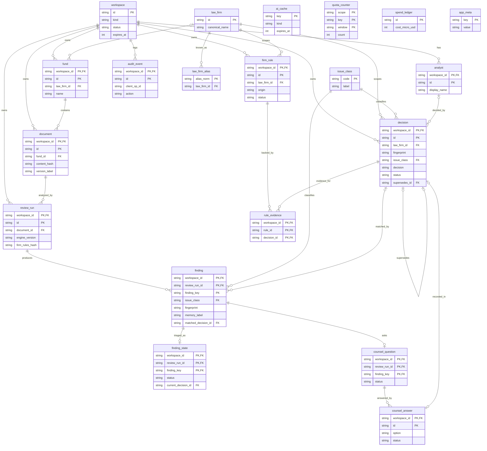

# INNOVATE (revision R6): Approach A extended with a D1-backed Review Memory service and the full data model

Step 0 audit line: I restated the locked SPEC (64 ACs; new sections J to N; modified AC1/2/6/19/20/21/22/27/38; R6) plus the P4 and contract-lint/compare-cli feasibility verdicts. The question explored is how Approach A absorbs a persistent, workspace-isolated, append-only memory on Workers Free + D1 Free. Session-start discovery used the orchestrator-provided paths. The 5-persona debate (vc-predict method) and the strategy comparison (7 signals) were applied inline, because I have no skill-invocation tool. Nothing was modified.

## BLUF and TL;DR

- **Approach A holds.** The engine stays in the browser. The Worker stays thin. D1 becomes the system of record for memory, rules, audit and the counsel workflow.
- **IndexedDB shrinks** to document bytes, parsed-model cache, UI state, drafts and an offline outbox. It no longer holds decisions.
- **One fingerprint implementation** lives in `packages/core`, using synchronous pure-JS SHA-256 (`@noble/hashes`, MIT). The browser uses it for lookups. The Worker re-computes it on every decision write and rejects mismatches.
- **Workspace and analyst identity** ride in the existing signed cookie. Every table row carries `workspace_id`. Tables use `PRIMARY KEY (workspace_id, id)` as `WITHOUT ROWID`, and parent links are composite foreign keys, so cross-workspace links are impossible at the database level.
- **The "active decision" is a unique row.** A partial unique index allows at most one `status='active'` decision per (workspace, firm, fingerprint). The lookup is one query for all ~200 findings.
- **The demo workspace is copied into each new sandbox** (copy-on-write at creation). Nobody ever holds a cookie bound to the demo workspace, and triggers back that up.
- **Rule proposals are computed on write.** The same batch that stores a dismissal also checks for 3+ same-reason dismissals. No cron or Queues needed.
- **Retention purge is lazy**: one set-based purge batch, claimed at most once per hour, triggered by new sessions.
- **Cron on Workers Free is believed to exist but is unverified here.** The design does not depend on it.
- **Nothing exceeds ~20 D1 queries per invocation** (limit 50). The design is safe on query count only if multi-row writes use `json_each` or chunking, never one INSERT per finding.
- **Largest new risk:** D1 Free's 100k rows-written/day now gates memory and AI counters (fail-closed). Mitigations are lean rows, a best-effort tier for findings, and an outbox.
- **Feasibility gate:** every unverified D1 mechanism below has a correctness-preserving fallback that fits the limits. The approach does not hinge on any of them, so no VC-FEASIBILITY-PROBE-NEEDED halt is raised. They become Phase-0 spikes (section 6).

---

## 1. Architecture delta (vs the current Decision Summary)

| # | Area | Before | After (delta) | Why |
|---|---|---|---|---|
| 1 | D1 role | AI/OCR cache, counters, spend ledger | Also the system of record for workspaces, analysts, firms, funds, document metadata, review runs, findings (best-effort), decisions, counsel questions and answers, firm rules, rule evidence and the audit log | AC42, 55, 56, 58; the user's locked "server stores snippets, hashes and metadata" |
| 2 | Worker | `/api/ai`, `/api/ocr`, `/api/quota`, `/api/cache` | Adds `POST /api/session`, `POST /api/memory/lookup`, `POST /api/runs` and `POST /api/runs/:id/findings`, `POST /api/decisions`, `POST /api/decisions/:id/revoke`, `POST /api/counsel/questions` and `/answers`, `GET/POST /api/rules` (+ `/approve`, `/reject`, `/revoke`), `GET /api/memory/firms/:id`, `GET /api/audit`, `POST /api/runs/:id/export`, optional `GET /api/memory/export` (P1). Stays thin: no parsing, no document text (quotes are capped at 1000 chars and discarded after hashing). | A1 stays valid; P4 only forbids heavy CPU |
| 3 | `/api/ai` | Key = doc/page hash + model + prompt + schema | Request gains `law_firm_id`. The **Worker injects the firm's active rules** into the prompt, so a client cannot skip or forge them. Cache key adds `rules_hash`. | AC27, AC51; closes a cache-poisoning path |
| 4 | Cache key | `sha256(kind, input_hash, model, prompt_ver, schema_ver)` | Adds `rules_hash` = sha256 of the sorted, normalized active rule texts (not ids). `rules_hash='none'` when no rules. Static precomputed samples are named `/precomputed/{docHash}.{rulesHash8}.json`. | AC27. Hashing texts only keeps the demo seed and every sandbox copy at the same hash, so AC34 (sample opens with zero AI calls) holds. |
| 5 | IndexedDB (Dexie) | Decisions, answers, undo log, export/import | Document bytes, parsed-model cache, filter/UI state, unsaved drafts (dismiss notes, counsel wording), UI undo stack, and a **decision outbox** (idempotent retry queue). Undo is now a server "revoke". No local memory read-cache: if lookup fails, all findings show New plus a "Memory unavailable" banner (the safe direction). | Server is the source of truth |
| 6 | Fingerprint location | n/a | Both, one implementation: `packages/core/memory/{normalize,fingerprint,mask,label,rulesHash}.ts`. Browser computes for lookups and drafts. Worker **recomputes on every decision write** (`422 fingerprint_mismatch` on disagreement). | One implementation prevents drift. Verifying only writes keeps CPU small, and a forged read only hurts the forger's own sandbox. |
| 7 | Hash library | WebCrypto (0.3 ms for 380 KB) | `@noble/hashes` sha256 for fingerprints (sync, pure JS, identical bytes in browser/Worker/Node). WebCrypto stays for HMAC/cache keys. | Hashing 200 short quotes via async WebCrypto might cost 5 to 10 ms of CPU. Pure-JS over about 60 KB is under 1 ms. |
| 8 | Label logic | n/a | Pure function `resolveLabel(finding, activeDecision)` in core. It runs in the browser for display and in the Worker when snapshotting labels into `finding`. **No SQL CASE duplicate.** | One label implementation |
| 9 | Identity | Signed cookie + daily-salted IP hash (limits) | Cookie payload gains `{w: workspace_id, a: analyst_id, iat, kid}`. HMAC-SHA256 verified statelessly (about 0.1 ms, no D1 query). Cookie is `__Host-sid; HttpOnly; Secure; SameSite=Lax`. Mutating calls also check `Origin` and a custom header. Every repository function requires `ctx.workspaceId` from the cookie. No endpoint accepts a workspace id from the client. | AC56 |
| 10 | Workspace enforcement | n/a | (1) Single data-access module owns all SQL; each statement binds `workspace_id`. (2) All tables use composite PK `(workspace_id, id)`; child links are composite FKs. (3) Test that every repository statement contains `workspace_id`. (4) Two-session e2e. | AC47, AC56 |
| 11 | Demo workspace | n/a | `workspace.kind='demo'` holds the seed. **New sandboxes are created as a copy of the demo seed** (`INSERT ... SELECT` with ids `sandbox_id||':'||demo_id`, so rule evidence maps without an id table). Cookies are only ever issued for `kind='sandbox'`. Triggers also block writes to demo rows (outside seed mode) on the memory tables. Rejected: read-only overlay (see section 7). | AC57. Copy keeps "memory never crosses workspaces" literally true and keeps the unique-active-row invariant per workspace. |
| 12 | Rule proposal (R9) | n/a | **Computed on write**, inside the dismissal batch (section 4e). A proposal is a `firm_rule` row with `status='proposed'`. No cron, Queues or read-time scan. | AC53, AC54 |
| 13 | Retention purge | Lazy purge for cache | One lazy purge batch (section 4g) claimed via `UPDATE app_meta ... RETURNING`, run from new sessions at most once per hour. Sandbox expiry is sliding. The demo is exempt. | AC38, AC58. Cron Triggers on Free are believed available (about 5 per account) but **UNVERIFIED**, so the design stays lazy-first. |
| 14 | Findings persistence | none (browser only) | Best-effort tier. Findings are written once per run in chunks of at most 50 via `json_each`, used for metrics (AC59, AC64) and memory-page provenance. If D1 budget is tight they are skipped (decisions and audit are the essential tier). | Protects the D1 write budget |
| 15 | Fail-closed rule | counters in D1 | If D1 is unavailable or over quota: no paid AI (counters unreachable), memory shows "unavailable", decisions queue in the outbox, deterministic review continues | AC25, AC26, AC40 |
| 16 | Tests | pool-workers + local D1 | Same pool; adds migration application, trigger tests, fingerprint vectors in three runtimes, query-count and rows-written assertions from the D1 `meta` object | section 5 |
| 17 | Unchanged | | Browser engine, shared structurer, detectors, diff, DOCX export, OCR pipeline, no R2/KV/DO, Turnstile on first AI call, request-counted quotas, static assets | |

CPU check (P4 style): memory endpoints do HMAC verify (about 0.1 ms), JSON parse of at most 128 KB (about 0.3 ms), one sha256 per decision write (about 0.01 ms), and response serialization (under 0.5 ms). Estimated total is about 1 to 3 ms, with D1 wait time not counted as CPU. This is estimated; S10 measures it in workerd.

Query-budget assumption: treat D1 queries and outbound fetches as one shared budget of 50 per invocation (worst case). Section 2.9 shows the worst endpoint uses about 20.

---

## 2. D1 data model (SQLite dialect)

### 2.0 Conventions

- Timestamps are `INTEGER` epoch milliseconds UTC.
- Ids are `TEXT` (`prefix_` + ulid/uuid from `newId()`). Copied seed ids are `sandboxId||':'||seedId`.
- **Workspace-scoped tables** use `PRIMARY KEY (workspace_id, ...)` and `WITHOUT ROWID`. That clusters rows by workspace, needs no extra unique index, and lets child tables use composite FKs. One row written per insert unless secondary indexes exist.
- **Global tables:** `law_firm`, `law_firm_alias`, `issue_class`, `app_meta`, `ai_cache`, `quota_counter`, `spend_ledger`. These hold no per-workspace memory.
- **CHECK** is used only for small, stable closed sets (decision, status, kind, reason code, label, detector kind, option). Evolving sets use a reference table with an FK (`issue_class`) or zod-only validation (audit `action`). Reason: SQLite cannot alter a CHECK without a table rebuild.
- D1 enforces foreign keys. In batches, insert parents first (or use `PRAGMA defer_foreign_keys`).
- Free-tier realities used: bound parameters per query at most 100; statement text at most 100 KB; row at most 2 MB; at most 50 queries per invocation; at most 100k rows written/day (index entries count) and 5M rows read/day. Treat all as assumptions to confirm in S8/S9.
- A `json_each(?)` parameter lets one statement carry up to about 100 findings with a single bound parameter.

### 2.1 Tables

#### `app_meta` (global; key/value)
Purpose: schema/seed versions, seed-mode flag, purge slot claim, rough write-budget estimate. ACs: AC38, AC58, AC40.

| Column | Type | Null | Notes |
|---|---|---|---|
| key | TEXT | no | PK. e.g. `schema_version`, `seed_version`, `seed_mode`, `last_purge_at`, `d1_write_estimate:{yyyymmdd}` |
| value | TEXT | no | |
| updated_at | INTEGER | no | |

#### `workspace`
Purpose: a sandbox or the seeded demo. ACs: AC56, AC57, AC58.

| Column | Type | Null | Notes |
|---|---|---|---|
| id | TEXT | no | PK. Demo id is fixed, `ws_demo` |
| kind | TEXT | no | CHECK IN ('demo','sandbox') |
| status | TEXT | no | DEFAULT 'active', CHECK IN ('active','purging') |
| seed_version | INTEGER | yes | which demo seed was copied |
| created_at, last_active_at | INTEGER | no | `last_active_at` touched at most once per day per workspace (saves writes) |
| expires_at | INTEGER | yes | NULL for demo (purge-exempt). Sliding: `last_active_at + RETENTION` capped by `created_at + MAX_LIFETIME`. Values set in PLAN. |

CHECK: `(kind='demo') = (expires_at IS NULL)`. Index: `ix_ws_expiry (expires_at) WHERE kind='sandbox'`.

#### `analyst`
Purpose: simulated identity chosen on entry (not real auth). ACs: AC42, AC55, AC56.

| Column | Type | Null | Notes |
|---|---|---|---|
| workspace_id | TEXT | no | FK workspace(id) |
| id | TEXT | no | |
| display_name | TEXT | no | length 1 to 60 |
| is_seed | INTEGER | no | 0/1 |
| created_at | INTEGER | no | |

PK (workspace_id, id), WITHOUT ROWID. The audit and decision rows also snapshot the name.

#### `law_firm` (global reference)
Purpose: canonical firm list. Loaded by migration (not user-editable). ACs: AC41, AC43.

| Column | Type | Null | Notes |
|---|---|---|---|
| id | TEXT | no | PK, stable slug, e.g. `partners-group`. Used inside fingerprints. |
| canonical_name | TEXT | no | |
| name_norm | TEXT | no | UNIQUE |

#### `law_firm_alias` (global)
Purpose: alias resolution ("Firm X LLP" = "Firm X"). AC41.

| Column | Type | Null | Notes |
|---|---|---|---|
| alias_norm | TEXT | no | PK (lowercase, punctuation stripped) |
| law_firm_id | TEXT | no | FK law_firm(id) |

Index: `ix_alias_firm (law_firm_id)`. The same list is also generated as a static `firms.json`, so the UI picker needs no endpoint. "Other / no firm" is allowed. In that case no memory is applied and the app says so.

#### `issue_class` (global reference)
Purpose: the defect taxonomy as an FK target, so adding a class is an INSERT, not a table rebuild.

| Column | Type | Null | Notes |
|---|---|---|---|
| code | TEXT | no | PK. broken_cross_reference, broken_conditional, unreachable_or_circular_flow, option_gap_overlap, defined_term_issue, inconsistent_footnote_requirement, logic_contradiction, ambiguity, meaningful_typo, version_drift, drafting_note, placeholder, sensitive_data, investor_path_dead_end, investor_path_missing_item |
| label | TEXT | no | |
| sort | INTEGER | no | |

The PRD's six classes map onto these. The PRD list is too coarse for the taxonomy.

#### `fund`
Purpose: fund name within a workspace and firm. ACs: AC41, AC49, AC59.

| Column | Type | Null | Notes |
|---|---|---|---|
| workspace_id | TEXT | no | FK |
| id | TEXT | no | |
| law_firm_id | TEXT | yes | FK law_firm; NULL = no firm |
| name, name_norm | TEXT | no | |
| created_at | INTEGER | no | |

PK (workspace_id, id). Unique index `uq_fund (workspace_id, IFNULL(law_firm_id,''), name_norm)`.

#### `document`
Purpose: metadata and content hash only. No bytes, no text. ACs: AC1, AC2, AC41, AC64.

| Column | Type | Null | Notes |
|---|---|---|---|
| workspace_id | TEXT | no | |
| id | TEXT | no | |
| fund_id | TEXT | no | composite FK (workspace_id, fund_id) |
| law_firm_id | TEXT | yes | snapshot of the fund's firm |
| display_name | TEXT | no | length at most 120 |
| format | TEXT | no | CHECK IN ('html','pdf','docx','scan_pdf','image') |
| content_hash | TEXT | no | sha256 of file bytes |
| size_bytes, page_count | INTEGER | no / yes | |
| version_label | TEXT | yes | the "version / template" label |
| source | TEXT | no | CHECK IN ('upload','sample') |
| sample_id | TEXT | yes | |
| upload_started_at, created_at | INTEGER | yes / no | `upload_started_at` is for the AC64 timer |

PK (workspace_id, id). UNIQUE (workspace_id, fund_id, content_hash). The same file under a different fund is a new row.

#### `review_run`
Purpose: one analysis of a document under pinned versions, plus delivery metrics. ACs: AC8, AC27, AC59, AC64.

| Column | Type | Null | Notes |
|---|---|---|---|
| workspace_id, id | TEXT | no | |
| document_id | TEXT | no | composite FK |
| law_firm_id | TEXT | yes | snapshot |
| engine_version, prompt_version, schema_version | TEXT | no | |
| fp_version | INTEGER | no | DEFAULT 1 |
| firm_rules_hash | TEXT | no | `'none'` when no rules |
| memory_mode | TEXT | no | CHECK IN ('applied','no_firm','unavailable') |
| ai_mode | TEXT | no | CHECK IN ('off','full','degraded') |
| status | TEXT | no | CHECK IN ('running','det_done','complete','partial','failed'); `stage_failed` TEXT |
| findings_total, blocking_total | INTEGER | no | counts |
| first_exportable_at, sheet_exported_at | INTEGER | yes | AC64 timer = `sheet_exported_at - document.upload_started_at` |
| sheet_question_count | INTEGER | yes | batched questions (AC64) |
| created_at | INTEGER | no | |

PK (workspace_id, id). UNIQUE (workspace_id, document_id, engine_version, firm_rules_hash): re-running the same inputs is idempotent, and AI findings append to the same run. Index: `ix_run_doc (workspace_id, document_id, created_at DESC)`.

#### `finding` (immutable engine output; best-effort tier)
Purpose: per-run findings with masked evidence and a snapshot of the memory label. ACs: AC7, AC36, AC43, AC59.

| Column | Type | Null | Notes |
|---|---|---|---|
| workspace_id, review_run_id, finding_key | TEXT | no | PK triple; `finding_key` = engine-stable id (AC8) |
| issue_class | TEXT | no | FK issue_class |
| pattern_key | TEXT | yes | detector-supplied pattern signature, used for rule proposals (section 2.4) |
| severity | TEXT | no | CHECK IN ('critical','high','medium','low'); critical = blocks digitization |
| detector_kind | TEXT | no | CHECK IN ('rule','ai') |
| detector_id | TEXT | no | rule id or AI task id |
| model | TEXT | yes | required when detector_kind='ai' |
| provenance | TEXT | yes | CHECK IN ('fresh','cache') for AI |
| confidence | REAL | no | CHECK between 0 and 1 |
| anchor | TEXT | no | block anchor |
| section_path | TEXT | yes | |
| page | INTEGER | yes | OCR page |
| region_json | TEXT | yes | OCR region |
| quote_snippet | TEXT | no | masked, CHECK length at most 300 |
| quote_hash, fingerprint | TEXT | no | CHECK length = 64 |
| detail_json | TEXT | yes | explanation facts + interpretations, CHECK length at most 2000 |
| memory_label | TEXT | no | CHECK IN ('new','previously_dismissed','already_answered','awaiting_counsel','dismissed_reconfirm') (snapshot at persist time; the UI recomputes live) |
| matched_decision_id | TEXT | yes | composite FK to decision |
| created_at | INTEGER | no | |

PK (workspace_id, review_run_id, finding_key), WITHOUT ROWID, **no secondary index** (one row written per finding). FK (workspace_id, review_run_id) to review_run. CHECK `(detector_kind='ai') = (model IS NOT NULL)`.

#### `finding_state` (mutable working state, 1:1, created on first touch)
Purpose: analyst triage and edits. Not memory. ACs: AC6, AC22, AC48.

| Column | Type | Null | Notes |
|---|---|---|---|
| workspace_id, review_run_id, finding_key | TEXT | no | PK; composite FK to finding |
| status | TEXT | no | CHECK IN ('open','accepted','dismissed','answered') |
| needs_counsel | INTEGER | no | 0/1 |
| severity_override, text_override | TEXT | yes | |
| current_decision_id | TEXT | yes | composite FK to decision |
| updated_by_name, updated_at | TEXT / INTEGER | no | |

WITHOUT ROWID, no secondary index. Absence of a row means open. Gate rule (in core): a blocking finding with label `dismissed_reconfirm` stays unresolved until `status` is dismissed or answered via a decision recorded in this run.

#### `decision` (append-only memory)
Purpose: every Accept / Dismiss / Answered with the full record. Exact DDL below. ACs: AC6, AC42, AC43 to AC50, AC53, AC58.

| Column | Type | Null | Notes |
|---|---|---|---|
| workspace_id, id | TEXT | no | PK |
| law_firm_id | TEXT | no | FK law_firm. Decisions exist only for documents with a firm. |
| fingerprint | TEXT | no | CHECK length 64 |
| fp_version | INTEGER | no | DEFAULT 1 |
| issue_class | TEXT | no | FK issue_class |
| pattern_key | TEXT | yes | copied from the finding |
| quote_hash | TEXT | no | |
| quote_snippet | TEXT | no | masked, at most 300 chars |
| section_path | TEXT | yes | |
| fund_name, doc_version_label | TEXT | no / yes | snapshots, so seed copies need no fund rows |
| origin_fund_id, origin_document_id, origin_review_run_id, origin_finding_key | TEXT | yes | provenance, NULL for seeds or when findings are not persisted |
| decision | TEXT | no | CHECK IN ('accepted','dismissed','answered') |
| reason_code | TEXT | yes | CHECK IN ('firm_standard_wording','no_form_impact','tool_false_alarm','other') |
| note | TEXT | yes | at most 500 |
| counsel_option | TEXT | yes | CHECK IN ('A','B','C','unclear') |
| counsel_note | TEXT | yes | at most 1000 |
| counsel_answer_id | TEXT | yes | composite FK to counsel_answer; NULL for seeds |
| decided_by_analyst_id | TEXT | yes | |
| decided_by_name | TEXT | no | |
| decided_at | INTEGER | no | |
| status | TEXT | no | CHECK IN ('active','superseded','revoked') |
| supersedes_id, superseded_by_id | TEXT | yes | self FK |
| revoked_by_name, revoked_at, revoke_reason | | yes | all required when status='revoked' |
| seed_of | TEXT | yes | demo decision id this row was copied from |

Row-level CHECKs: dismissed requires `reason_code` (AC6, enforced in the database, not only the UI); answered requires `counsel_option`; revoked requires `revoked_at` and `revoke_reason`.

```sql
CREATE TABLE decision (
  workspace_id TEXT NOT NULL REFERENCES workspace(id),
  id TEXT NOT NULL,
  law_firm_id TEXT NOT NULL REFERENCES law_firm(id),
  fingerprint TEXT NOT NULL CHECK (length(fingerprint)=64),
  fp_version INTEGER NOT NULL DEFAULT 1,
  issue_class TEXT NOT NULL REFERENCES issue_class(code),
  pattern_key TEXT,
  quote_hash TEXT NOT NULL CHECK (length(quote_hash)=64),
  quote_snippet TEXT NOT NULL CHECK (length(quote_snippet)<=300),
  section_path TEXT,
  fund_name TEXT NOT NULL, doc_version_label TEXT,
  origin_fund_id TEXT, origin_document_id TEXT,
  origin_review_run_id TEXT, origin_finding_key TEXT,
  decision TEXT NOT NULL CHECK (decision IN ('accepted','dismissed','answered')),
  reason_code TEXT CHECK (reason_code IN
    ('firm_standard_wording','no_form_impact','tool_false_alarm','other')),
  note TEXT CHECK (length(note)<=500),
  counsel_option TEXT CHECK (counsel_option IN ('A','B','C','unclear')),
  counsel_note TEXT CHECK (length(counsel_note)<=1000),
  counsel_answer_id TEXT,
  decided_by_analyst_id TEXT, decided_by_name TEXT NOT NULL,
  decided_at INTEGER NOT NULL,
  status TEXT NOT NULL DEFAULT 'active'
    CHECK (status IN ('active','superseded','revoked')),
  supersedes_id TEXT, superseded_by_id TEXT,
  revoked_by_name TEXT, revoked_at INTEGER, revoke_reason TEXT,
  seed_of TEXT,
  PRIMARY KEY (workspace_id, id),
  CHECK (decision <> 'dismissed' OR reason_code IS NOT NULL),
  CHECK (decision <> 'answered'  OR counsel_option IS NOT NULL),
  CHECK (status <> 'revoked' OR (revoked_at IS NOT NULL AND revoke_reason IS NOT NULL)),
  FOREIGN KEY (workspace_id, supersedes_id) REFERENCES decision(workspace_id, id)
) WITHOUT ROWID;

-- at most ONE active decision per workspace+firm+fingerprint; also the lookup index
CREATE UNIQUE INDEX uq_decision_active
  ON decision(workspace_id, law_firm_id, fingerprint) WHERE status = 'active';
-- memory page (filter by issue class, newest first)
CREATE INDEX ix_decision_page
  ON decision(workspace_id, law_firm_id, issue_class, decided_at DESC);
-- rule-proposal counting
CREATE INDEX ix_decision_pattern
  ON decision(workspace_id, law_firm_id, pattern_key, reason_code)
  WHERE decision = 'dismissed' AND status = 'active';

-- append-only enforcement (purge is the only exception, gated by workspace.status)
CREATE TRIGGER decision_no_delete BEFORE DELETE ON decision
WHEN (SELECT status FROM workspace WHERE id = OLD.workspace_id) IS NOT 'purging'
BEGIN SELECT RAISE(ABORT, 'decision_append_only'); END;

CREATE TRIGGER decision_guard_update BEFORE UPDATE ON decision
WHEN NEW.id IS NOT OLD.id OR NEW.fingerprint IS NOT OLD.fingerprint
  OR NEW.quote_hash IS NOT OLD.quote_hash OR NEW.decision IS NOT OLD.decision
  OR NEW.reason_code IS NOT OLD.reason_code OR NEW.note IS NOT OLD.note
  OR NEW.counsel_option IS NOT OLD.counsel_option OR NEW.counsel_note IS NOT OLD.counsel_note
  OR NEW.decided_at IS NOT OLD.decided_at OR NEW.decided_by_name IS NOT OLD.decided_by_name
  -- ... every immutable column listed ...
  OR NOT (OLD.status = 'active' AND NEW.status IN ('superseded','revoked'))
BEGIN SELECT RAISE(ABORT, 'decision_immutable'); END;
```

Notes:
- The "latest non-revoked" resolution is enforced structurally: superseding a decision flips the old row to `superseded` and inserts the new `active` row in one atomic batch. The unique index makes a race fail loudly (409), not silently.
- Revoking does not resurrect a superseded predecessor. After a reopen the fingerprint has no active row, so the finding is New (AC50).
- A decision's `quote_hash` and fingerprint are computed over the evidence sentence. Stored text is only the masked snippet.

#### `counsel_question`
Purpose: one drafted question per finding that goes to counsel. ACs: AC20, AC21, AC64.

| Column | Type | Null | Notes |
|---|---|---|---|
| workspace_id, review_run_id, finding_key | TEXT | no | PK; composite FK to finding |
| draft_text | TEXT | no | generated (template or AI), at most 2000 |
| edited_text | TEXT | yes | analyst edit (AC20) |
| interpretations_json | TEXT | no | the A/B/C options, at most 2000 |
| position | INTEGER | no | order in the sheet |
| status | TEXT | no | CHECK IN ('drafted','exported','answered') |
| exported_at, created_at | INTEGER | yes / no | |

WITHOUT ROWID, no secondary index. Rows exist only for New and Accepted needs-counsel findings. Already answered and Awaiting counsel findings never get one (AC45).

#### `counsel_answer` (append-only)
Purpose: record counsel's reply. ACs: AC21, AC45.

| Column | Type | Null | Notes |
|---|---|---|---|
| workspace_id, id | TEXT | no | PK |
| review_run_id, finding_key | TEXT | no | composite FK to counsel_question |
| option | TEXT | no | CHECK IN ('A','B','C','unclear') |
| note | TEXT | yes | at most 1000 |
| answered_by_name, answered_at | | no | |
| status | TEXT | no | CHECK IN ('active','revoked') |
| revoked_at, revoke_reason | | yes | |

Index: `ix_answer_q (workspace_id, review_run_id, finding_key, answered_at DESC)`. Same immutability triggers as `decision`. Recording an answer also writes a superseding `answered` decision that carries the option and note denormalized, so lookup stays a one-table read.

#### `firm_rule`
Purpose: per-firm rules (manual or proposed). Given to the AI as context and never used as a filter. ACs: AC51 to AC54.

| Column | Type | Null | Notes |
|---|---|---|---|
| workspace_id, id | TEXT | no | PK |
| law_firm_id | TEXT | no | FK law_firm |
| origin | TEXT | no | CHECK IN ('manual','proposed') |
| status | TEXT | no | CHECK IN ('proposed','active','rejected','revoked') |
| rule_text | TEXT | no | CHECK length 1 to 500. Editable only while `status='proposed'`, enforced by trigger. |
| proposal_key | TEXT | yes | `issue_class|pattern_key|reason_code` |
| created_by_name, created_at | | no | |
| decided_by_name, decided_at | | yes | approval / rejection |
| revoked_by_name, revoked_at, revoke_reason | | yes | |
| seed_of | TEXT | yes | |

CHECK `origin='proposed' OR (status IN ('active','revoked'))`. UNIQUE `uq_rule_proposal (workspace_id, law_firm_id, proposal_key) WHERE proposal_key IS NOT NULL`. A key is proposed at most once, ever, so a rejected proposal never re-appears. Index: `ix_rule_firm (workspace_id, law_firm_id, status)`.

#### `rule_evidence` (m2m)
Purpose: the decisions behind a proposal, shown at approval. ACs: AC53, AC54.

| Column | Type | Null | Notes |
|---|---|---|---|
| workspace_id, rule_id, decision_id | TEXT | no | PK triple; composite FKs to firm_rule and decision |
| added_at | INTEGER | no | |

WITHOUT ROWID, no secondary index.

#### `audit_event` (append-only)
Purpose: who did what and why. Doubles as the idempotency guard for retries. ACs: AC50, AC55.

| Column | Type | Null | Notes |
|---|---|---|---|
| workspace_id, id | TEXT | no | PK; id is time-sortable |
| client_op_id | TEXT | no | UNIQUE (workspace_id, client_op_id) |
| at | INTEGER | no | |
| analyst_id | TEXT | yes | |
| actor_name | TEXT | no | simulated identity, labeled as such in the UI |
| action | TEXT | no | zod enum (no CHECK): session_created, decision_recorded, decision_revoked, answer_recorded, rule_added, rule_proposed, rule_approved, rule_rejected, rule_revoked, counsel_sheet_exported |
| law_firm_id | TEXT | yes | |
| entity_type, entity_id | TEXT | yes | |
| reason | TEXT | yes | |
| detail_json | TEXT | yes | at most 1000 |

Indexes: `ix_audit_ws_time (workspace_id, at DESC)`, `ix_audit_firm (workspace_id, law_firm_id, at DESC)`. Triggers: no UPDATE, no DELETE (except purge). Every write operation produces exactly one audit row, inserted first in its batch. A replayed `client_op_id` aborts the whole batch, which makes outbox retries idempotent.

#### `ai_cache` (global)
Purpose: AI/OCR/draft results with TTL. ACs: AC27, AC34, AC36.

| Column | Type | Null | Notes |
|---|---|---|---|
| key | TEXT | no | PK = sha256(kind\|input_hash\|model\|prompt_ver\|schema_ver\|rules_hash) |
| kind | TEXT | no | CHECK IN ('ai','ocr','counsel_draft') |
| input_hash, model, prompt_version, schema_version, firm_rules_hash | TEXT | no | stored for debugging |
| result_json | TEXT | no | CHECK length at most 1,500,000 |
| bytes, hits | INTEGER | no | |
| created_at, expires_at | INTEGER | no | about 7 days |

Index: `ix_cache_exp (expires_at)`. The Worker derives the key from the payload it actually forwards (hash of the final messages), not from client-claimed hashes. OCR results here hold page text transiently, which is covered by the privacy notice. This is not memory.

#### `quota_counter` (global)
Purpose: per-visitor and global daily caps, rate-limit buckets, spend total. ACs: AC32, AC33, AC35, AC39.

| Column | Type | Null | Notes |
|---|---|---|---|
| scope, key, window | TEXT | no | PK triple. e.g. scope `visitor_ai` / `global_ai` / `rate` / `spend` / `session_new`; window = UTC day or minute bucket |
| count | INTEGER | no | requests, or micro-USD for spend |
| updated_at | INTEGER | no | |

WITHOUT ROWID. `UPDATE ... SET count=count+? WHERE count+?<=cap RETURNING count` claims units atomically. Old windows are purged lazily. A new `session_new` scope rate-limits sandbox creation per IP hash.

#### `spend_ledger` (global)
Purpose: every paid or free LLM/OCR call. ACs: AC26, AC33.

| Column | Type | Null | Notes |
|---|---|---|---|
| id | TEXT | no | PK |
| at | INTEGER | no | |
| kind | TEXT | no | CHECK IN ('llm','ocr') |
| model | TEXT | no | |
| tokens_in, tokens_out | INTEGER | yes | |
| cost_micro_usd | INTEGER | no | |
| outcome | TEXT | no | CHECK IN ('ok','failed','refunded') |
| cache_key | TEXT | yes | |
| visitor_hash | TEXT | yes | daily-salted. **No FK to workspace**, so purge cannot delete spend history. |

Index: `ix_spend_at (at)`.

### 2.2 Fingerprint formula and normalization (aligned with the PRD)

```
normalize(q):
  1. Unicode NFC
  2. remove invisible chars: U+00AD, U+200B..U+200D, U+FEFF
  3. toLowerCase()   (locale-independent)
  4. unify quotes: U+201C/U+201D -> '"'   and   U+2018/U+2019 -> "'"
  5. collapse every run of Unicode whitespace (incl. U+00A0) to one space, then trim
  Keep digits, section numbers, punctuation, dashes, footnote markers.  Nothing else changes.

quote_hash  = hex( sha256( normalize(evidence_quote) ) )
fingerprint = hex( sha256( "fp1|" + law_firm_id + "|" + issue_class + "|" + quote_hash ) )
```

- `evidence_quote` is the **document's own sentence** containing the finding. For AI findings the engine locates the model's quote in the document (AC28) and then snaps to the document's sentence, never the model's wording. This removes the PRD's "model quotes slightly differently each run" risk. The quote is capped at 1000 chars. Longer is rejected and not truncated.
- `"Section 4"` versus `"Section 5"` produce different hashes (AC46). Case, spacing and quote-style differences match.
- `law_firm_id` is the alias-resolved slug, which fixes the PRD's "Firm X LLP" versus "Firm X" split.
- `fp1` is a version prefix. A future normalization change makes old decisions simply not match, which means findings show as New. That is the safe direction.
- **Sensitive-data findings** (bank/routing numbers): the detector's flagged span is replaced by `#` plus its last 4 digits before normalization, in the browser. Both the hash and the snippet use the masked text, so the server never sees or stores the raw value, and the hash cannot be brute-forced offline. Tradeoff: two different numbers with the same last 4 digits would match. Surfaced as a PLAN decision (section 6, risk M5). Only `sensitive_data` spans are masked, so numbers elsewhere are still kept.
- **Conformance vectors:** `fixtures/fingerprint-vectors.json` (case, whitespace, quote, NBSP, 4-versus-5, sensitive, firm A versus B) must pass in Node, in workerd (pool-workers) and in the Playwright browser bundle.

### 2.3 "Active decision for a fingerprint" and the lookup

Resolution: the single `status='active'` row for (workspace_id, law_firm_id, fingerprint). No window function or "latest" ordering is needed.

Lookup for all findings in one query (one bound parameter holding a JSON array of up to ~200 fingerprints):

```sql
SELECT d.fingerprint, d.id, d.decision, d.reason_code, d.note,
       d.counsel_option, d.counsel_note, d.fund_name, d.doc_version_label,
       d.decided_by_name, d.decided_at
FROM decision d
WHERE d.workspace_id = ?1 AND d.law_firm_id = ?2
  AND d.status = 'active'                       -- literal, so the partial index applies
  AND d.fingerprint IN (SELECT value FROM json_each(?3));
```

- The plan should read `SEARCH decision USING INDEX uq_decision_active`. A test asserts this via `EXPLAIN QUERY PLAN`.
- A 200-finding document costs **1 query** (about 13 KB parameter). Rows read: about 200 index seeks plus at most 200 row fetches, far inside 5M/day.
- **Fallback if `json_each` or its parameter size misbehaves on D1 (S8):** `IN (?,?,...)` chunks of 90 fingerprints (100-parameter cap minus 2 scope parameters), giving 3 queries for 200 findings.
- Labels come from core `resolveLabel`:

| Active decision | Blocking finding? | Label |
|---|---|---|
| none | any | New |
| dismissed | yes | "Dismissed in [fund], re-confirm" (main list; gate unresolved until re-confirmed) |
| dismissed | no | Previously dismissed |
| answered (A/B/C) | any | Already answered, prior answer shown, not in sheet |
| answered `unclear` | any | New (counsel's reply did not resolve it). PLAN confirms. |
| accepted, no answer | any | Awaiting counsel, not sent again |

Revoked and superseded rows never match.

### 2.4 Rule-proposal pattern

Exact fingerprints rarely repeat three times, because memory moves a repeat to "Previously handled". The proposal rule therefore uses `pattern_key`, a short deterministic signature each detector emits. Examples: `defined-term:units->shares`, `ref:part-b-of-section`. It excludes numbers and is limited to rule detectors plus AI findings classed by task. A proposal needs at least 3 distinct active `dismissed` decisions with the same (workspace, firm, pattern_key, reason_code). Reason `other` never proposes. Threshold constant `RULE_PROPOSAL_MIN=3` lives in core. This needs a per-detector `pattern_key` spec in PLAN (risk M7).

### 2.5 Query budget (worst case per Worker invocation; limit 50)

| Endpoint | D1 queries | Notes |
|---|---|---|
| `POST /api/memory/lookup` (about 200 fingerprints) | 1 (3 on fallback) | |
| `POST /api/runs` | 3 | upserts for fund, document and run, in one batch |
| `POST /api/runs/:id/findings` (at most 50 findings) | 2 (at most 10 on fallback) | read active decisions, then multi-row insert via `json_each`. Labels computed in the Worker via the core function. |
| `POST /api/decisions` | about 6 | audit insert, supersede, insert, state upsert, proposal check (2) |
| `POST /api/decisions/:id/revoke` | about 4 | |
| `POST /api/counsel/answers` | about 7 | |
| `POST /api/rules/:id/approve` | about 4 | |
| `POST /api/session` | 6; about 20 if it claims the purge slot | |
| `/api/ai` | about 8 queries plus 1 fetch | rules read, quota claims, cache read/write, ledger |
| Purge batch | 14 plus 3 | |

A 200-finding document in total: 1 lookup + 3 run upserts + 4 finding chunks (8) across about 6 separate requests. The worst single invocation is about 20 (under 50), so **it fits**. A per-row INSERT loop (200 queries) would **not**, so it is forbidden by design.

Rows-written estimate:

| Operation | Approx rows written (incl. index entries) |
|---|---|
| Persist a 200-finding run | about 200 |
| One decision (supersede + insert + state + audit) | about 10 to 12 |
| Session creation with demo copy | about 40 |

100k/day therefore allows roughly 200 busy visitors/day. S9 calibrates this from the `meta.rows_written` that D1 returns.

---

## 3. Mermaid ER diagram



`ai_cache`, `quota_counter`, `spend_ledger` and `app_meta` are intentionally standalone (global, no foreign keys). `counsel_answer` is linked to `counsel_question` by a composite FK that the diagram shows only as the relationship line.

---

## 4. Key flows (numbered; query counts in brackets)

**(a) Review a document with memory lookup and labeling**
1. Analyst picks firm (static `firms.json`; alias resolved), fund and version label, then uploads or picks a sample. Bytes stay in the browser (IndexedDB).
2. Browser engine produces findings. Each gets `quote_hash` and `fingerprint` via core (sensitive spans masked first).
3. `POST /api/memory/lookup {law_firm_id, fingerprints[]}` [1 query]. If no firm, skip and show "memory not applied". If D1 fails, label everything New and show the banner.
4. Browser runs `resolveLabel` per finding and renders: main list gets New plus "Dismissed in [fund], re-confirm"; the collapsed "Previously handled (n)" gets the rest.
5. In the background (best-effort, outbox-safe): `POST /api/runs` [3], then `POST /api/runs/:id/findings` in chunks of at most 50 [2 each]. The Worker re-resolves labels with the same core function and stores them as snapshots.
6. AI pass (if on): `/api/ai {law_firm_id, candidates}`. The Worker reads active rules [1], computes `rules_hash`, claims quota, checks the cache by key including `rules_hash`, calls the LLM, caches, and writes the ledger. AI findings join the run.

**(b) Dismiss with reason**
1. UI requires a reason from the fixed list (the database CHECK also enforces it).
2. `POST /api/decisions {client_op_id, finding ref, decision:'dismissed', reason_code, note, quote_text, fingerprint, issue_class, pattern_key, fund_name, ...}`.
3. Worker verifies cookie and scope, recomputes `fingerprint` from `quote_text` (`422` on mismatch), builds the masked snippet and drops the full quote.
4. Single `db.batch` (atomic): insert `audit_event` (first; a duplicate `client_op_id` aborts the batch, so retries are safe) -> flip the previous active row (if any) to `superseded` -> insert the new `active` decision -> upsert `finding_state` -> rule-proposal check (4e). [about 6]
5. A unique-index violation returns `409` with the current active decision. On network failure the UI keeps the action in the outbox and shows "unsynced".

**(c) Record counsel answer**
1. Analyst chooses A/B/C/unclear plus a note on a counsel question.
2. `POST /api/counsel/answers {client_op_id, question ref, option, note, quote_text, fingerprint, ...}`.
3. One batch: audit -> insert `counsel_answer` -> supersede the previous active decision for that fingerprint (usually `accepted`) -> insert an `answered` decision carrying option, note and `counsel_answer_id` -> update `counsel_question.status` -> upsert `finding_state` to answered. [about 7]
4. The next fund's lookup returns this row. The finding is Already answered (or New if the option was `unclear`) and never gets a counsel question.

**(d) Reopen**
1. `POST /api/decisions/:id/revoke {reason, client_op_id}` (reason required).
2. Batch: audit -> `UPDATE decision SET status='revoked', revoked_* WHERE id=? AND status='active'` -> update `finding_state` to open if it pointed at this decision. [about 4]
3. The next lookup finds no active row, so the finding is New. History is kept. UI "undo" uses the same call with reason "undo".
4. If zero rows were updated (already superseded or revoked), return `409` with the current state.

**(e) Rule proposal after 3+ same-reason dismissals, then approval**
1. Inside the dismissal batch (4b), when `reason_code <> 'other'` and the finding has a `pattern_key`: one statement runs `INSERT OR IGNORE INTO firm_rule(... origin='proposed', status='proposed', proposal_key ...) SELECT ... FROM decision WHERE workspace_id=? AND law_firm_id=? AND pattern_key=? AND reason_code=? AND decision='dismissed' AND status='active' GROUP BY ... HAVING COUNT(*) >= 3`. The `uq_rule_proposal` index guarantees at most one proposal per key.
2. A second statement does `INSERT OR IGNORE INTO rule_evidence` for all matching decisions (extra evidence appends as later dismissals arrive).
3. A proposed rule has no effect: the `/api/ai` rules read filters `status='active'`.
4. UI shows "Proposed rules (n)" with the evidence list. `POST /api/rules/:id/approve` [about 4]: audit -> `status='active'`, `decided_by/at` -> (optional edited text, only while proposed). Reject sets `rejected` and the key is never proposed again. Either way an audit row is written.
5. Approval changes `rules_hash`, so the next AI run is a cache miss (AC27) and subject to the usual caps. If the caps are hit, the AI lane shows "rules changed, AI re-run unavailable" and serves no stale-rules AI findings.

**(f) Sandbox creation plus demo seed**
1. First visit: `POST /api/session {analyst_name, turnstile?}`. Claim the `session_new` rate-limit counter per IP hash.
2. Batch: insert `workspace(kind='sandbox', expires_at)`, insert the `analyst`, then `INSERT ... SELECT` copies from `ws_demo` into the new workspace for `decision`, `firm_rule`, `rule_evidence` and a few seeded audit rows (ids `sandboxId||':'||seedId`; `seed_of` set). [6]
3. Issue the signed cookie. Nobody is ever given a cookie bound to `ws_demo`.
4. Seed source: `seed/demo.sql`, **generated by a script from `fixtures/` using core fingerprint code** (so the seeds can never drift from the real formula). It is applied with `seed_mode=1` (the only time the demo triggers allow writes). A CI step regenerates it and diffs.
5. If the D1 write estimate is over budget, skip copying and run the sandbox in read-only mode against the demo (lookup binds `ws_demo`; every write returns `read_only_demo`). This is the degrade path.

**(g) Retention purge (lazy)**
1. Triggered from `POST /api/session` only. Claim the slot: `UPDATE app_meta SET value=? WHERE key='last_purge_at' AND value < ? RETURNING value`. No rows means skip (at most one purge per hour).
2. Set-based and bounded: `UPDATE workspace SET status='purging' WHERE kind='sandbox' AND expires_at < ? AND id IN (SELECT id ... LIMIT 50)`, then one `DELETE ... WHERE workspace_id IN (SELECT id FROM workspace WHERE status='purging')` per child table in dependency order (rule_evidence, counsel_answer, counsel_question, finding_state, finding, review_run, document, fund, decision, firm_rule, audit_event, analyst), then delete the workspace rows. About 14 statements for up to 50 workspaces.
3. Also delete expired `ai_cache` rows (bounded by `rowid IN (SELECT ... LIMIT 500)`) and old `quota_counter` windows.
4. The "append-only" triggers allow DELETE only when `workspace.status='purging'`. The app has no other delete path.
5. Uploads are never on the server, so AC38's "stored uploads deleted" is met by the browser-side TTL on IndexedDB documents plus this server purge.
6. **Cron Triggers on Workers Free:** I believe they exist (about 5 per account) but I could not verify that here. If confirmed in S8, add a daily `scheduled()` run of the same purge batch as an extra safety net. The lazy path remains the baseline.

---

## 5. Migrations, versioning and test hooks

**Migrations**
- `migrations/NNNN_*.sql`, applied by `wrangler d1 migrations apply` (tracks its own `d1_migrations` table). Forward-only. Additive first.
- Planned order: `0001_core_tables`, `0002_memory_tables_triggers`, `0003_reference_seed` (law firms, aliases, issue classes), `0004_cache_quota_ledger`.
- `app_meta.schema_version` is set by the last statement of each migration. The Worker compares it to the expected value at `/api/health` and **refuses writes on mismatch** (503), so a half-deployed schema fails closed.
- Changing a CHECK means a table rebuild (create, copy, drop, rename, recreate triggers). Avoid it by using `issue_class` as an FK and a zod-only audit `action`. Normalization changes bump the `fp` prefix; engine or prompt changes bump `engine_version` / `prompt_version` (cache and run keys).
- Demo seed: `seed/demo.sql` is generated and applied separately. It carries its own `seed_version` in `app_meta`.

**Test hooks (all local, no network)**
- `@cloudflare/vitest-pool-workers` with `readD1Migrations` + `applyD1Migrations` in setup. The local D1 is real SQLite, so triggers, partial indexes, `WITHOUT ROWID` and composite FKs get exercised.
- Fingerprint vectors in Node, workerd and Playwright.
- `memory-label-matrix`, `fingerprint-normalization-property`, `decision-record-contract`, `decision-append-only` (attempt UPDATE/DELETE and expect failure), `rule-proposal-threshold-matrix`.
- Tenant tests: `memory-no-cross-firm-or-workspace`, `sandbox-isolation`, a statement-lint test that every repository query binds `workspace_id`, a composite-FK cross-workspace insert test.
- `demo-workspace-not-polluted` (attempt a write against `ws_demo` outside seed mode, expect failure).
- `EXPLAIN QUERY PLAN` assertion for the lookup. Query-count and `meta.rows_written` assertions per endpoint.
- Idempotency: replay the same `client_op_id` and assert no second row.
- Purge test with a fake clock and a demo-exempt assertion.
- Storage contract: scan stored rows for more than 300 chars of snippet, unmasked sensitive values, or any full-text column.
- OpenRouter stub for the `rules_hash` cache-key tests.

---

## 6. Updated risks, new spikes, and phase order

### New and changed risks

| ID | Risk | Severity | Mitigation |
|---|---|---|---|
| M1 | D1 Free 100k rows-written/day (index entries count) now gates memory and the AI counters (fail-closed) | High | `WITHOUT ROWID`, at most 2 indexes on hot tables, findings are a best-effort tier, `last_active` touched once a day, write-estimate guard, outbox, banner |
| M2 | Cookie cleared means the sandbox is lost | Medium | Stated in the UI. P1: JSON export of the workspace memory plus import |
| M3 | Sandbox-minting abuse burns write budget | Medium | `session_new` counter per IP hash, Turnstile on creation, lazy purge |
| M4 | Two tabs decide the same fingerprint | Low | Partial unique index plus `409` with the current decision |
| M5 | Brute-forcing masked sensitive numbers, and last-4 collisions | Medium | Mask before hashing (2.2). PLAN confirms last-4 versus fully masked. |
| M6 | AI quote wording varies run to run | Medium | Snap to the document's own sentence; temperature 0 |
| M7 | `pattern_key` needs a per-detector spec, and the demo needs 3 same-pattern dismissals to show proposals | Medium | PLAN defines it; seed it in the fixtures |
| M8 | Audit "who" is a simulated name | Low | Labeled "simulated analyst" everywhere |
| M9 | `answered/unclear` handling is an edge case outside the PRD | Low | Treated as New; PLAN confirms |
| M10 | Unverified D1 behaviors (section 2.1 and 2.3) | Medium | S8, each with a fallback |
| M11 | Demo precompute must match the seeded rules hash and frozen prompts | Medium | Generated by the same script as the seed; CI diff |
| M12 | Schedule: the PRD estimates half a day, but the full memory stack (Worker, D1, UI, tests) is much larger | Medium | P1 cut order: rule proposal (AC53/54), firm memory page (AC52), outline export (AC63), firm rules as AI context (AC51), then firm export |

### New spikes (Phase 0, non-blocking for PLAN; failure never breaks correctness)

| # | Question | Cost class | If it fails |
|---|---|---|---|
| S8 | D1 SQL surface: `json_each` with one array parameter, 100-parameter cap, partial unique index use (EXPLAIN), triggers with `RAISE`, `WITHOUT ROWID` plus composite FKs, `RETURNING`, trigger behavior during purge DELETEs, whether batched statements and fetches share the 50-per-invocation budget, and Cron Triggers on Free | cheap-local for SQL (miniflare); needs-cf for limits and cron | Chunked `IN` lists (3 queries per 200 findings); app-layer enforcement plus tests instead of triggers; explicit child-first deletes; lazy purge only |
| S9 | Rows-written calibration: persist a 200-finding run, a decision, a session; read `meta.rows_written` | needs-cf | Tighten the best-effort findings tier or drop finding persistence |
| S10 | Cold-start CPU of the memory path in workerd: HMAC verify, JSON parse of 128 KB, `@noble/hashes`, validation library choice (zod versus a lighter one) | needs-cf | Lighter validator; smaller chunk size |

Existing S1 to S7 stay as they were; S5 is subsumed by S8/S9 for the D1 parts.

### Updated suggested phase order (PLAN validates)

| Phase | Scope | Depends on |
|---|---|---|
| 0 | Scaffold and spikes S1 to S10 | none |
| 1 | Core model, HTML adapter, structurer, graph, finding schema, golden detectors, test harness. **Adds** `core/memory` (normalize, fingerprint, mask, label, rulesHash) with the conformance vectors. **Adds** the memory API contract (zod schemas) so web and worker can proceed in parallel | 0 |
| 2 | Remaining detectors, flags, terms, seeded fixtures. **Adds** investor-type path extraction and its detectors (AC61, AC62), `pattern_key` per detector, and the fund I / fund II fixtures | 1 |
| 3 | Web shell: reading view, findings, triage, structure view, investor-path view. **Adds** the label UI, the "Previously handled (n)" section, the dismiss-with-reason dialog and the outbox, against a stub memory API | 1 |
| 4a | Worker: proxy, limits, Turnstile, abuse tests | 0 |
| 4b | **New:** D1 schema and migrations, session/cookie, memory repository and endpoints, audit, rules, purge, seed generator | 0, 1 (contract) |
| 5 | LLM tasks, recordings, AI lane UI, provenance, quota banners. **Adds** Worker-side rules injection and `rules_hash` in cache keys | 2, 3, 4a, 4b |
| 6 | PDF/DOCX adapters, OCR pipeline, precompute (precompute now keyed by `rules_hash`) | 1, 4a |
| 7 | Version diff. **Adds** sibling common-versus-differing clause labeling (AC19) | 2 |
| 8 | Counsel sheet, answers, gate (with re-confirm state), DOCX export, memory write-back, sheet exclusion rules, delivery metrics panel (AC64) | 3, 5, 7, 4b |
| 8b | **New (P1):** firm memory page, audit viewer, firm rules UI, rule proposals and approval, workspace JSON export | 4b, 8 |
| 9 | Form logic outline export (AC63, P1) | 2, 3 |
| 10 | Deploy, a11y, perf, final precompute, fund II e2e (AC59, AC60), README/video/slides | all |

Phases 3, 4a and 4b can run in parallel once the Phase-1 memory contract exists.

---

## 7. Revised Decision Summary

### Chosen Approach
**Approach A extended: browser-first engine + thin Cloudflare Worker, with D1 as the system of record for per-law-firm Review Memory** (workspaces, append-only decisions, firm rules, audit), carried by a signed cookie and protected by composite-key tenant isolation. Rationale: it satisfies the new memory scope and the locked Free-tier limits without changing the engine split, because every new Worker endpoint is a few D1 queries and about 1 to 3 ms of CPU.

### Why This Over Alternatives

| Alternative | Why Rejected |
|---|---|
| Memory in IndexedDB only (browser-only sandbox, demo seed as a static JSON) | Genuinely the simplest option, but it contradicts the locked "server stores snippets, hashes and metadata with retention", gives no shared audit or team view (US17, US19), loses memory on cache clear, and makes AC56 to AC58 trivial rather than real. It is kept only as the degrade path (outbox plus "memory unavailable"). |
| Memory in KV | 1k writes/day; no relational constraints |
| Durable Objects per workspace | Locked out (Free plan only) |
| Demo as a live read-only overlay (union of demo and sandbox in every lookup) | Needs precedence and tombstone logic. Breaks the literal "memory never crosses workspaces" and the unique-active-row invariant. Kept only as the budget-exhausted fallback. |
| Labels computed in SQL | Duplicates the core label logic. One pure function used by browser and Worker is safer. |
| Fingerprint computed only in the browser (or only in the Worker) | Browser-only lets a client forge memory. Worker-only costs about 200 hashes per lookup and ships quotes needlessly. Chosen: one shared implementation, Worker verifies on writes. |
| Rule proposals via cron/Queues, or computed on read | Cron is unverified on Free, Queues are out of scope, and a read-time scan is wasteful. Compute-on-write is atomic with the dismissal. |
| Per-row finding INSERTs | 200 queries exceeds the 50 limit. Use `json_each` or chunks. |
| Persisting all findings as essential data | Would put the daily write budget at risk. Findings are a best-effort tier; decisions and audit are essential. |
| FK-less workspace scoping (repo discipline only) | Strong isolation needs database-level help: composite PK/FK plus tests. |

### Risk Predictions (5-persona debate, vc-predict method, applied inline)
**Verdict: CAUTION, proceed.**

- **Architect:** agrees that A absorbs memory cleanly. Concerned about D1 now being a critical dependency. Resolved by the fail-closed and outbox design.
- **Security:** workspace isolation by composite keys and a signed cookie is sound. Remaining items are mask-before-hash for sensitive values (M5), CSRF (Origin plus SameSite), rule text being prompt context (length cap, delimited block), and the simulated identity being spoofable by design.
- **Performance/Ops:** all endpoints fit CPU and query limits (about 20 queries worst case). The real constraint is the 100k rows-written/day budget (M1). Spikes S8, S9 and S10 calibrate it.
- **UX:** the main list stays small, "Previously handled (n)" stays visible, and the blocking re-confirm is clear. Needs a clear "unsynced" and "memory unavailable" state.
- **Devil's Advocate:** the PRD's half-day estimate is optimistic; browser-only memory would be much simpler. Answered by the locked constraint, and by documenting the P1 cut order (M12).

### Key Constraints Accepted
- Memory lookup is exact-match only, with fingerprint formula `sha256("fp1|"+firm+"|"+class+"|"+sha256(normalize(quote)))`. Numbers and section numbers are kept.
- Decisions, answers and audit are append-only. Only a controlled sandbox purge deletes anything, enforced by triggers gated on `workspace.status='purging'`.
- At most one active decision per workspace, firm and fingerprint, enforced by a partial unique index.
- All memory endpoints stay within about 20 D1 queries per invocation. Multi-row writes must use `json_each` or chunking.
- Findings persistence is best-effort. If D1 is unavailable, no paid AI runs, memory shows "unavailable", and decisions queue in the outbox.
- The Worker, not the client, injects firm rules into AI prompts and derives cache keys from the payload it forwards.
- The demo workspace is never bound to a cookie. Each sandbox is a seeded copy.
- Sensitive spans are masked in the browser before hashing and before storage.
- PLAN must define: retention values, per-detector `pattern_key`, last-4 masking policy, `unclear` answer handling, and composite-FK scope.
- Relevant shared skills for PLAN: `vc-generate-plan`, `vc-docs-seeker` (D1, vitest-pool-workers, `@noble/hashes` API shapes), `vc-scenario` and `vc-security` (auth/identity, schema/migration, secrets risk classes). The active plan inventory is `process/general-plans/active/subdoc-qa-mvp_17-10-26/`; no phase plans exist yet.

### PLAN strategy recommendation (vc-agent-strategy-compare, 7-signal score)
Score **5/7 (HIGH)**. Present signals: S1 multi-package (core, web, worker), S2 schema/API/auth surface, S4 phase program (11 phases), S6 high-risk class (identity, schema/migration, secrets), S7 5+ files. Absent: S3 and S5.

| Option | Verdict |
|---|---|
| Sequential | **Invalid** for 3+ phase plans (Phase Program rule) |
| Parallel subagents | Not recommended: phase plans share blast radius (core contracts, D1 schema, API) and need cross-talk |
| Workflow | Overkill; the phase count is known |
| **Agent team** | **Recommended.** About 5 members (core/engine planner, worker/D1 planner, web planner, test/validation planner, security reviewer), 2 rounds, so about 10 agent-runs (under the 30-agent cost guard). All sonnet; opus only for later EXECUTE work. |

Key coordination points for the team: the Phase-1 memory API contract (shared by 3, 4b and 8), non-overlapping blast radii between the Worker and web plans, and the Phase 4b to 5 hand-off on `rules_hash`.

PHASE_COMPLETE: INNOVATE — Decision Summary written

Ready to create detailed plan. Say 'go' to move to PLAN mode.

**Status:** DONE_WITH_CONCERNS
**Summary:** Approach A is extended with a D1-backed Review Memory service: a 19-table workspace-isolated data model, a one-query active-decision lookup, flows (a) to (g), migrations and tests, a revised Decision Summary, and an agent-team PLAN recommendation.
**Concerns/Blockers:** Several D1 and Workers Free behaviors are unverified (this session had no network or runtime probes): `json_each` with one array parameter, the 100-parameter cap, trigger and purge-DELETE interplay, whether batch statements and fetches share the 50-per-invocation budget, and Cron Triggers on Free. Each has a fallback that preserves correctness and the limits, so none blocks PLAN; they are spikes S8 to S10. The 100k rows-written/day budget is the main operational risk. PLAN must still decide retention values, per-detector `pattern_key`, the last-4 masking policy and `unclear`-answer handling. I wrote no files; the orchestrator should persist this content.
